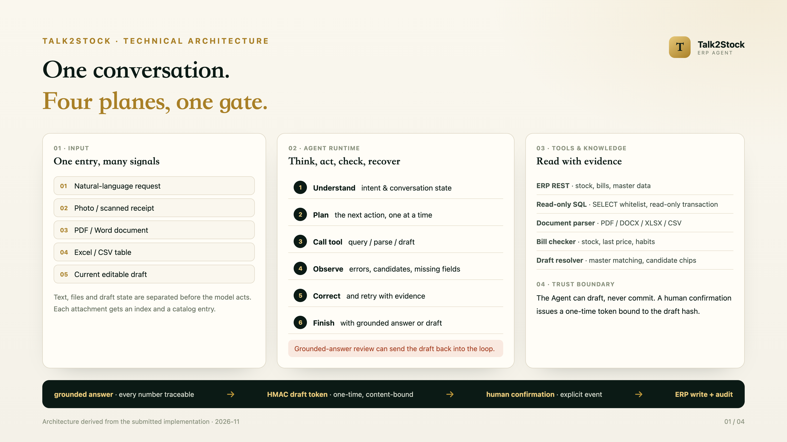
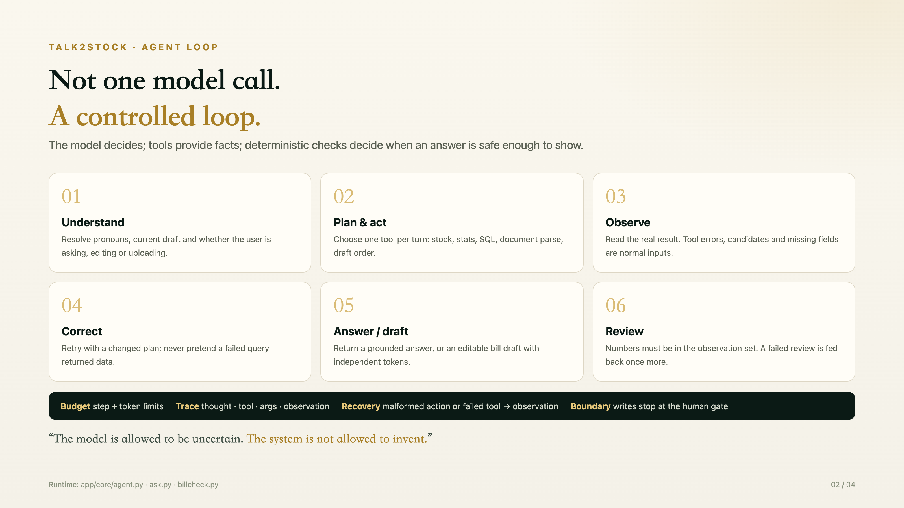
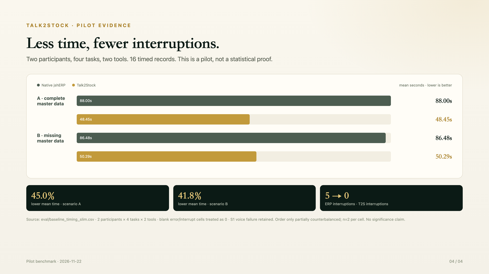
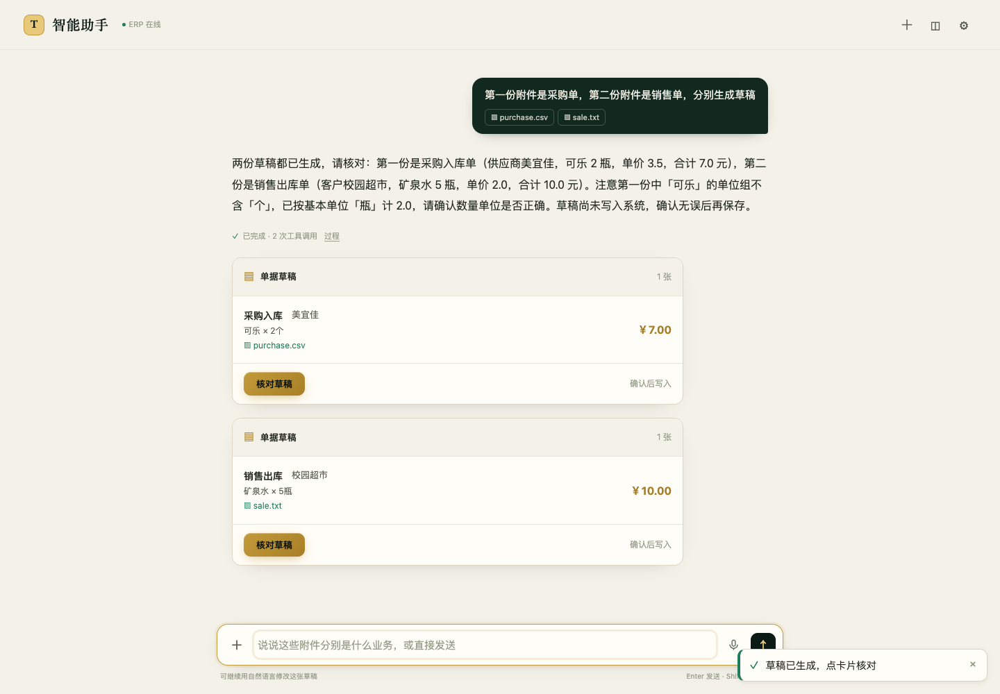
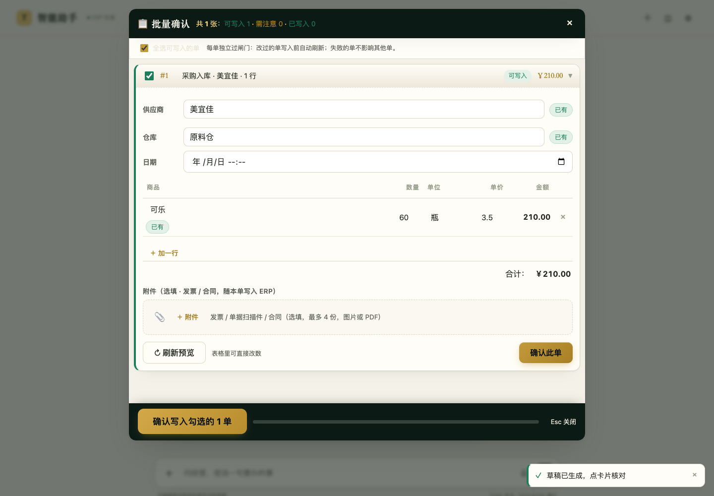

# Talk2Stock: A Conversational Business Agent on a Real ERP

**Final Report**

| Item | Value |
|---|---|
| Group ID | L0X / Group X (to fill) |
| Project title | Talk2Stock — Conversational Business Agent on a Real ERP |
| Sponsor / user | Credible proxy users (two teammates with no ERP experience) and external issue feedback (GitHub #1, #2) |
| Platform & frameworks | AI coding tools: ZCode, Codex, Claude Code; runtime: Python 3.12 standard library (zero third-party runtime dependencies); native HTML/CSS/JS; jshERP (open-source ERP); OpenAI-compatible model APIs |
| Deployed system | http://111.91.30.23:8090/ (`/` returns 302 to `/ask`) |
| Submission date | 2026-12-20 |

> Final submission: English PDF, 10–15 pages excluding appendices, 11 pt, named `L0X_GroupX_final.pdf`. This DOCX is the editable source.

---

## 1. Executive Summary

Small trading companies already run an ERP, but an ERP assumes an operator who knows every field and whose master data is complete. In reality, the person entering bills is rarely an ERP expert, and new suppliers, products and specifications appear continuously. We separate the cost into two parts: a **translation cost** (turning one spoken sentence into supplier, product, quantity, unit, price, warehouse and date) and a **master-data repair cost** (discovering that a supplier or product does not exist, leaving the bill form, creating the record elsewhere, then starting over). Measured on the native jshERP UI, a single purchase receipt for “3 bottles of cola from Meiyijia” takes roughly **25 clicks and two flow interruptions**.

Talk2Stock is a conversational front end on top of a real open-source ERP. The ERP itself is untouched and all reads/writes go through its official REST API. The model understands language, plans, selects tools and explains; deterministic code owns matching, validation, arithmetic and tokens; the human keeps the final write decision. The system supports single- and multi-bill entry from text, forms, spreadsheets and images; grounded question answering; an operations dashboard; procurement suggestions; and multi-step business diagnosis.

Measured results: in a controlled pilot of 16 timed records, scenario A fell from 88.00 s to 48.45 s and scenario B from 86.48 s to 50.29 s, while ERP-side interruptions fell from five to zero (n=2, descriptive only). The frozen bill-entry corpus reaches 98.3% whole-bill accuracy with zero hallucinated fields; the frozen Q&A corpus reaches 94.1%–95.0%; the unified-agent smoke test passes 5/5; 206 offline tests pass; and the public link opens outside the group.

---

## 2. Problem and GenAI Task

### 2.1 Business problem and users

The users are not ERP administrators. They are four real roles:

| Role | Situation | What the system provides |
|---|---|---|
| Bill-entry clerk / operations assistant | Knows the business facts, not ERP vocabulary; every interruption restarts the task | Text, multi-bill, spreadsheet and image entry; draft preview; clarification for missing fields; candidate selection |
| Warehouse / operations | Needs a number now, not a report walk | Read-only Q&A: stock, daily/monthly statistics, bills, receivables, arbitrary read-only SQL |
| Owner / manager | Needs conclusions and anomalies, not tables | Nine-card dashboard; procurement suggestions; AI insight; daily report; deep diagnosis |
| One-person company / small shop | One person does everything; nobody builds master data or teaches the tool | Master data created with the bill; sentence-level entry; single-container deployment |

Need validation comes from three sources: national statistics on small trading businesses, public ERP onboarding documents (Yonyou, Jiandaoyun, Xiangguohe), and two real issues on the public repository. **Issue #1** (“AI is not for poor people”) argued that an AI cannot reliably match one accessory with multiple specifications. Checking the code against each claim showed that three and a half of the four technical points were real; we rewrote the matching layer, added eight specification cases to the frozen corpus, and made “never silently pick the first same-name record” a hard invariant. **Issue #2** came from another open-source author: “Interested in adapting my ERP?” This shows the demand is not only a course demo but a real migration request between systems. Our answer is per-system adaptation, not a pretend universal provider.

**What the evidence changed in the design.**

| Evidence | Design change |
|---|---|
| Issue #1: same-name products with different specifications | Ambiguity returns candidates with model numbers; `material_id` points directly at the chosen record; specification digits are preserved by both prompt and cleaning rules; eight specification cases frozen into the corpus |
| Issue #2: request to adapt another ERP | Explicit adapter boundary: the current system binds to the jshERP REST contract; a second system would reuse the agent/tool/trust layers but rewrite the adapter, not a universal provider |
| Pilot observation: users left the form to create suppliers | Master data is created with the bill; the draft marks “to create” and one confirmation creates both record and bill |
| Pilot observation: users did not trust unexplained values | Every field on the confirmation card carries a source label (extracted / matched / default / to create) |
| Pilot observation: phone use in the warehouse | 390 px layout, bottom tab bar and a single-line input were added and verified in a browser |

### 2.2 Why generative AI

Non-generative approaches fail in three places: unbounded user language (“Meiyijia delivered thirty bottles of cola at 3.5 each”), unknown spreadsheet headers (Kingdee, Yonyou, handwritten sheets), and unknown attachment formats (photos, PDFs, mixed files). These are language and structure judgment problems, which LLMs handle well. Quantities, prices, stock, debt, tokens and writes are not judgment problems; deterministic code must own them. The value of GenAI here is **not to do the bookkeeping, but to translate between human language and the ledger while admitting when it does not know.**

The product boundary follows: the agent is autonomous up to a draft; it cannot submit, delete, or modify existing bills; the ERP remains the system of record and the human remains the write decision-maker.

### 2.3 What the finished system does

One entry point that can query, draft, repair spreadsheets and explain the business; every write stops at a human confirmation card; every number can be traced back to a tool observation.

---

## 3. System Design and Implementation

### 3.1 Architecture and a real request trace

The system is split into four layers by *failure mode*:

- **Entry layer**: text, up to six files, images, current draft state; a single `/api/ask` endpoint plus SSE stream.
- **Agent runtime**: a hand-written JSON action loop (`core/agent.py`, 319 lines). Each turn the model returns `{thought, tool, args}` or a final answer; the server executes the tool and feeds the observation back. Step budgets are 4/5/8/10 by entry.
- **Fact tools**: ERP REST (stock, bills, master data, debt), read-only SQL (SELECT allowlist, read-only transaction, row/time limits), BM25 retrieval over documents and historical bills, spreadsheet/PDF/DOCX/CSV parsing, and draft validation.
- **Trust layer**: confirmation card, content hash, one-time HMAC token, nonce blacklist, audit log, seed rollback.

{width=88%}

**Full trace of one real request** (input → each intermediate input/output → final result):

> User: “Buy 30 bottles of cola from Meiyijia at 3.5 each, into the raw-material warehouse.”

1. **Entry layer** receives text and conversation context; no attachment or image. It assembles the system prompt from the tool catalog, master-data reference and conversation history.
2. **Agent decision 1**: the model reads the catalog, identifies a new purchase receipt, selects `draft_order` with `{text: <utterance>}`. Input: natural language. Output: one tool name and its arguments as JSON.
3. **Tool execution (drafting)**: `llm.parse` extracts business type, party, lines, quantity, unit, price and warehouse; `billcheck` performs read-only checks (stock, historical price, operator habit, party history); `draft.prepare_bills` matches master data and builds a preview with source labels (extracted / matched / default / to-create); `gate.issue` hashes the draft and signs a one-time token. Input: utterance plus master data. Output: draft JSON, preview, token.
4. **Agent decision 2**: the model reads the observation (draft created, missing fields, whether clarification is needed) and produces the final answer: “Draft created; please verify… submit on the confirmation card.” Input: structured observation. Output: natural language that may not contain numbers absent from the observation.
5. **Grounding check**: every number in the answer is compared with tool observations; a mismatch sends the answer back once, then a deterministic template is used.
6. **Human confirmation**: the card shows party, warehouse, lines, quantities, units, prices, total and warnings. Editing any field refreshes the preview and re-signs the token.
7. **Write**: `/api/commit` verifies token signature, draft hash and unused nonce, then calls the official ERP REST API and appends an audit record (utterance, model, prompt version, diff, result). Input: confirmed draft. Output: an ERP bill number.
8. **Result**: a reviewable purchase receipt exists in the ERP; the agent never wrote to the database directly.

This trace answers the three required questions: **what the input is** (language, master data, attachments), **what the AI does** (intent, tool choice, parameter extraction, answer composition, correction after observation), and **what the output is** (a source-labelled draft, a grounded answer, and one human-confirmed write).

### 3.2 Models and parameters

- **Platform**: any OpenAI-compatible endpoint. Model profiles are managed in the settings page; keys are read from `.env` and never stored in `config.json`.
- **Models**: DeepSeek V4.1 Flash, Qwen3.8-Flash-Next and GLM profiles are interchangeable under the same prompt and tool contract. A separate low-latency model can be assigned to decision steps (`llm.agent_model`), separating short JSON actions from long-form generation.
- **Key parameters**: low temperature; decision output capped at 2,000 tokens (reasoning models otherwise spend the budget on thinking and truncate the JSON); `reasoning_effort=low`; step budgets by entry (Q&A 8, daily report 5, diagnosis 10, generic 4); the token budget is a fuse, not the main constraint.
- **Prompt design**: role and JSON contract; business-type enum; “copy master-data names verbatim” rule; specification digits belong to the name; date block converting today/yesterday into absolute dates; master-data reference; conversation context; no-invented-numbers rule. The complete prompt is in Appendix B.
- **Why these models**: the task is Chinese colloquial input, structured JSON and tool selection; maximum model size is unnecessary. Low latency and stable JSON matter more. Under the same prompt, whole-bill accuracy across models ranges from 96.7% to 98.3%, with differences driven mainly by network variance and JSON stability.

### 3.3 Data and knowledge retrieval

- **Sources**: jshERP business REST; read-only SQL over the ERP database; uploaded XLSX/CSV/PDF/DOCX/images; BM25 indexes over operating documents and historical bills.
- **Permissions**: ERP-account login (password never stored); admin/member roles; read-only SQL with an allowlist and read-only transaction; private model profiles per user; tenant isolation enforced by the ERP.
- **Preprocessing and refresh**: master data is fetched live with a short cache. Spreadsheets are inspected first (sheet list plus first eight rows), then the LLM proposes a header/column mapping with at most two bounded repair rounds; row-to-draft transformation is deterministic. BM25 indexes update incrementally with writes.
- **Why not vector RAG**: ADR-3 rejected it after evaluation. Business questions are dominated by exact numbers, time windows and rankings; vector recall tends to return “related but numerically wrong” content. Dedicated tools + read-only SQL + BM25 make retrieval a query that can be replayed.
- **When retrieval fails**: empty results and errors are fed back as observations; the model may switch tools or correct parameters once. If it still fails, it says “not found” rather than “no data”. Ambiguous products return the top three candidates with model numbers; the system never silently picks the first record.

**One real retrieval trace.** Question: “Which product sold best last month?” The model selects `sql_query` with a read-only aggregate over `jsh_depot_item × jsh_depot_head` (sale out, last calendar month, grouped by material, ordered by quantity, limit 5). The server executes it inside a read-only transaction with an allowlist and a row cap, and returns `[{name, qty}]`. The model then writes “last month the best seller was X, N units”, and the grounding check verifies that both the name and the number exist in the observation. If the table name is wrong, the database error is returned verbatim with candidate table names from `difflib`, and the model gets one chance to correct the query — this exact loop is covered by `tests/test_dbread_hint.py`.

### 3.4 Workflow and exception handling

```
User input
  → unified agent loop (model: intent / plan / tool choice)
      → deterministic tools (REST / read-only SQL / retrieval / file parsing / drafting / validation)
      → observation fed back (data, empty result, bad argument, SQL error, timeout)
      → model corrects or closes
  → grounding check (numbers must come from observations)
      → pass: answer / draft
      → fail: one rewrite, then deterministic template
  → draft: confirmation card → one-time token → human confirm → ERP write → audit
```

Exception handling is explicit: unknown tool → observation lists valid tool names; bad argument → field-level error; tool error → returned verbatim so the model can correct once; SQL unknown table → `dbread` uses difflib to return candidate table names; model 429/timeout → treated as an observation and retried, with an honest fallback when the step budget is exhausted; budget exhausted → one “answer-only” closing turn; grounding failure → one rewrite, then a template.

**Tool catalog (the model chooses; the server executes).**

| Tool | Input | Output | Purpose |
|---|---|---|---|
| `stock_query` | product, optional warehouse | per-warehouse stock | Stock question |
| `today_stats` / `month_stats` | — | purchase/sales counts and amounts | Period statistics |
| `debts` | — | receivable/payable top list | Who owes whom |
| `recent_bills` / `query_bills` | limit, time window, party, material | bill headers and lines | Bill lookup |
| `low_stock` / `stock_value` | threshold | low/negative list; total stock and value | Alerts and value |
| `master_count` | entity | count | Master-data count |
| `doc_search` | query | BM25 snippets | Operating docs and historical bills |
| `sql_query` | SELECT statement | rows | Anything the dedicated tools do not cover |
| `procurement_suggest` | window, cover days | reorder list with formula inputs | Procurement |
| `draft_order` | utterance, optional attachment id | draft, preview, token | Bill drafting |

{width=78%}

**Multi-bill entry and spreadsheet import.** A single utterance separated by semicolons, or several attachments, can produce a `bills[]` array; each bill gets its own preview and its own one-time token, and the batch preview submits them one by one. For spreadsheets, the flow is deliberately split: `inspect` returns the sheet list and first rows; the LLM only proposes the header row and column mapping (at most two bounded repair rounds); `transform` is deterministic; `resolve` builds row-level drafts with tokens; `commit` writes only the checked rows in blocks of ten. A repair agent reads failed rows and proposes a corrected mapping — it never writes. Attachments are numbered and the agent must select one by number or name; when the user does not specify, the tool refuses to guess and asks.

### 3.5 Write boundary (invariants)

| Invariant | Implementation | Failure prevented |
|---|---|---|
| No token, no write | `commit` rejects any request without a valid token | Direct API calls bypassing the UI |
| Token binds content | HMAC payload includes the draft hash | Edits after confirmation |
| One-time use | Persistent nonce blacklist rejects replay | Submitting the same confirmation twice |
| Pre-write check | Unresolved same-name lines are rejected | Half-written or wrong-record bills |
| Audit trail | Utterance, model, prompt version, diff, result | Cannot explain why a bill was written |

---

## 4. Evaluation and Improvement

### 4.1 Test design (criteria fixed before running)

| Test | Cases and source | Success criterion | Judge |
|---|---|---|---|
| Bill-entry parsing (end-to-end subtask) | 60 frozen cases + 8 specification cases from issue #1 | Whole-bill key fields correct; zero hallucinated fields; p95 latency | Human gold labels + scripted field comparison |
| Grounded Q&A (end-to-end) | 34 frozen questions (simple / multi-tool / compound / boundary), plus a 40-case version with draft cases | Correct answer; every number from tool observations; complete number set | Script + per-failure attribution |
| Unified-agent smoke | 5 core behaviours (query / statistics / draft / clarify / boundary) | 5/5 and grounded | Script |
| Human baseline | Two teammates with no ERP experience × 4 tasks × 2 tools = 16 timed records | Completion time, errors, interruptions | Live timing + raw notes |
| Offline regression | 206 unit/integration tests | All pass | CI + local |

End-to-end tests and model-subtask tests are kept separate: bill-entry evaluation judges only the final draft; Q&A judges only the final answer and grounding; unit tests cover the gate, matching, name cleaning, attachments and authentication outside the model.

**Why these cases represent real use.** The 60 general bill cases are written in the same colloquial style as the pilot utterances (names, units and prices embedded in one sentence); the 8 specification cases come directly from issue #1; the adversarial subset deliberately removes information (ambiguous business type, missing quantity) to test whether the system asks instead of inventing. The Q&A corpus mixes single-tool, multi-tool, compound and boundary questions because those are the four failure modes observed in the first prototype. The 16 timing records are the pilot's full set, including the failed voice attempt, rather than a curated subset.

### 4.2 Comparative results

Same inputs and same scoring rules across three generations:

| Approach | Configuration | Cases | Result |
|---|---|---|---|
| Native ERP, manual entry | jshERP UI | 16 timed records | Scenario A 88.00 s / B 86.48 s; five interruptions; about 25 clicks + 2 interruptions per bill |
| Rule-first prototype | Regex routing + single extraction | 34 questions / 60 bills | Q&A 76.5%; bill entry 78.3% (v1 prompt) |
| Unified agent (local frozen run) | Hand-written loop + tools + grounding | 34/40 questions; 60+8 bills; 5 smoke cases | Q&A 94.1%–95.0%; bill entry 98.3%, zero hallucinations; smoke 5/5 |
| Unified agent (deployed run, 2026-11-24) | Same code on the public instance, OpenRouter `deepseek/deepseek-v4.1-flash-1017`, deployed data | 71 bills; 34 questions | Bill entry 63/71 = 88.7% whole-bill, 1 hallucinated field, item_price 93.0%, mean 10.81 s / p95 14.05 s; Q&A 29/34 = 85.3%, zero fallbacks, mean 6.26 s / p95 16.16 s |

Note: generations use different corpora and prompts, so the numbers must not be compared naively. Each row states its corpus and version; raw results are kept in `eval/results/`. The deployed row measures a different model profile and a different ERP dataset from the local frozen row; the two are reported side by side, never averaged.

{width=78%}

### 4.3 Failure analysis

**F1 · Missing date (real iteration, v1 → v2)**
- Input: “Enter yesterday’s bill again.”
- Expected: convert “yesterday” to an absolute date and draft.
- Actual (v1): the prompt did not include today’s date; the model could not convert it and the bill could not be entered.
- Location: system prompt lacked a date block.
- Change: inject the current date and relative-date rules; keep date cases in the frozen corpus.
- Retest: date-related failures disappeared for both models; whole-bill accuracy rose from 78.3% to 98.3%.

**F2 · Rule layer hijacking compound questions**
- Input: “How much did we sell today? Also, what is the total stock value?”
- Expected: both numbers.
- Actual (old): the rule layer matched `today_stats` and answered only the first half.
- Location: regex intent matching with no compound guard.
- Change: rules left the decision seat; sub-questions are injected as an explicit list; every sub-question must be evidenced.
- Retest: compound behaviour improved and stayed in the corpus; the price is that even simple questions now pass through one decision call (see 4.4 and Section 5).

**F3 · Specification loss (real defect driven by issue #1)**
- Input: “20 boxes of M8 screws.”
- Expected: match the “screw / M8×20” record.
- Actual (old): with two same-name records the first was silently chosen (possibly M10×30), or the cleaning rule stripped “M8”.
- Location: no ambiguity guard in matching; prompt and cleaning logic disagreed about digits in names.
- Change: same-name records return `ambiguous` with model-number candidates; `material_id` selection points directly at the record; quantifiers became mandatory (“6号电池” is no longer stripped to “号电池”); eight specification cases entered the frozen corpus.
- Retest: specification set 8/8; 206 offline tests; an end-to-end write confirmed the correct record by barcode.

**F4 · Budget and gateway variance (not fully solved)**
- Symptom: a gateway injecting about 8.5K tokens per request, reasoning models spending the budget on short JSON, occasional 429s; the user sees “queried 8 steps but got no usable data”.
- Location: step/output budgets mismatched with gateway behaviour; 429s were retried as ordinary observations until the step budget was exhausted.
- Change: cap decision output, `reasoning_effort=low`, per-entry budgets, errors as observations; fail fast on 429.
- Status: the fallback never shows a fabricated number, but latency and success rate remain sensitive to external quotas — a deployment risk, not a model-capability claim.

**F5 · Deployed full run: price-field errors dominate (2026-11-24)**
- Input: the full 71-case bill corpus through `/api/parse` on the deployed instance (OpenRouter DeepSeek profile, deployed ERP data).
- Expected: 71 whole-bill matches. Actual: 63/71 = 88.7%; failures were item_price ×5, party ×2, biz+qty ×1, date ×1; one hallucinated field.
- Location: the deployed profile and dataset differ from the local frozen run; price failures cluster on multi-line or total-price cases, and the deployed run is slower (mean 10.81 s, p95 14.05 s) than the local run (2.6 s mean).
- Change: report the deployed number separately; do not mix it with the local 98.3%; add the case IDs to the failure list for the next prompt iteration.
- Retest / uncertainty: attributing price failures to model versus master-data differences requires the same model locally, which was blocked that day by the local gateway quota (429); this is an open item, not a solved one.

### 4.4 User feedback

Two teammates with no ERP experience, four tasks each with both tools, 16 formal records. Objective: scenario A 88.00 → 48.45 s (-45.0%), scenario B 86.48 → 50.29 s (-41.8%), interruptions 5 → 0. Subjective feedback clustered into three statements: “I did not have to leave the bill to create the supplier”, “I can see where each field came from”, and “it works on my phone”. Changes driven by this feedback: master data created with the bill, source labels on the confirmation card, a 390 px mobile first screen, and one-tap retry for failed answers.

Limitations: n=2, two records per cell, only partially counterbalanced; the result supports direction, not statistical significance. Subjective comments and objective timings are recorded separately; blank errors/interruptions count as zero; the voice-failure sample is kept rather than excluded.

---

## 5. Limitations and Future Work

Known limitations, each with a trigger and evidence:

1. **Bill-side scale boundary**: `/depotHead/list` with `search` pages unreliably; beyond about 200 bills of one type only the newest page is covered; on 260 real unpaid bills, receivables were understated by 23%.
2. **Compound questions**: 67% on the 34-case corpus, the weakest Q&A category.
3. **Input boundaries**: scanned PDFs must go through the image path (no local OCR); legacy binary `.doc/.xls` are unsupported.
4. **User-study scale**: pilot n=2; no formal SUS instrument yet.
5. **Deployment and quota**: single tenant, single instance; model-gateway quotas directly affect latency and success rate.
6. **No universal adapter**: only the jshERP REST contract is implemented.

Future work, each mapped to a limitation:

1. **Time-bucket/SQL aggregation for bills** — removes the 200-bill boundary and makes receivables trustworthy at 1,000+ bills.
2. **Compound-question decomposition and a frozen multi-bill/attachment end-to-end corpus** — closes the 67% gap and the “multi-bill only smoke-tested” evidence gap.
3. **A second ERP adapter pilot** — responds to issue #2; not a universal provider, but the same responsibility split adapted per system, starting with read-only Q&A plus drafting as the minimum loop.

**Production-readiness assessment (what is real, what is still a threshold).**

| Dimension | Current evidence | Production threshold |
|---|---|---|
| Data correctness | Draft validation, grounding, gate tests, controlled seed and rollback | Run the frozen corpus on every release branch and compare versions |
| Security | One-time HMAC, nonce replay protection, no keys in public config | HTTPS, mandatory authentication, credential rotation, write-refusal audit drill |
| Reliability | Deterministic fallback, errors as observations, per-step trace | Vendor timeout policy, queueing, operator-facing failure states |
| Scale | Read-only SQL aggregate passed at 1,200 bills; currently single-user | Concurrency and tenant-isolation tests on a release build |
| Operations | Seed script, database backup, audit ledger | Alerting, restore drills, on-call ownership |

---

## 6. Team Contributions and Reproducibility

### 6.1 Contributions

| Member | Student ID | Deliverables |
|---|---|---|
| (to fill) | (to fill) | Problem definition, need validation, user testing |
| (to fill) | (to fill) | Agent runtime, tool layer, prompt iteration |
| (to fill) | (to fill) | Drafting, gate, audit, authentication |
| (to fill) | (to fill) | Front end (assistant, confirmation card, dashboard, mobile) |
| (to fill) | (to fill) | Evaluation assets, baseline experiment, failure analysis |
| (to fill) | (to fill) | Deployment, CI, documentation and reproduction |

### 6.2 Development mode

Pure code with AI-assisted coding. Tools used: ZCode, Codex and Claude Code for code generation, refactoring, test completion and documentation. Verification of generated content: (1) every change runs the 206 offline tests and CI (`py_compile` + unittest + inline-JS syntax check); (2) model-behaviour changes must run the frozen evaluations and write raw results to `eval/results/`; (3) UI changes are checked in a browser at 1440 px and 390 px; (4) write-path changes follow copy-first, a four-artifact verification and a rollback drill. AI-generated content that did not pass these checks is not used as report evidence.

### 6.3 Access and reproduction

- URL: http://111.91.30.23:8090/ (opens outside the group; `/` redirects to `/ask`).
- Login: an ERP account (demo account in Appendix A; admin account for diagnosis and configuration).
- Local reproduction from the repository root:

```
python3 -I -m unittest discover -s tests     # 206 offline tests
python3 -I eval/seed_demo.py --yes            # restore the controlled demo dataset before evaluation
python3 -I eval/run_unified.py                # unified-agent smoke (5 cases)
python3 -I eval/run_ask.py                    # grounded Q&A corpus (34 cases)
python3 -I eval/run.py --tag <tag>            # bill-entry corpus (68 cases)
```

- Prerequisites: local jshERP/MySQL/Redis containers running; `app/.env` with ERP credentials and at least one model key.
- Evaluation rule: model, corpus version and measurement date are reported together; a run affected by gateway quota errors (429) is not used as a conclusion.

---

## Appendix A · Architecture and access

- Architecture: `docs/final/assets/architecture.png` (four layers).
- Agent loop: `docs/final/assets/agent-loop.png`.
- Attachment ownership: `docs/final/assets/attachments.png`.
- Access: http://111.91.30.23:8090/ ; demo account: (to fill).

{width=46%}

{width=30%}

{width=46%}

{width=46%}

{width=46%}

## Appendix B · Prompts

The bill-extraction system prompt contains the role and JSON contract, business-type enum, “copy master-data names verbatim”, “specification digits belong to the name”, the date block (today plus relative-date conversion), low-confidence marking and the no-invented-fields rule. The agent decision prompt contains the tool catalog, one action per turn, observations may be errors, numbers only from observations, step/close rules and out-of-scope refusal. The spreadsheet mapping prompt only decides the header row and column mapping, never guesses the business, and returns an empty mapping on failure. Full text: `SYSTEM_PROMPT`, `SHEET_MAP_PROMPT` in `app/core/llm.py` and the decision template in `app/core/agent.py`.

Excerpt from the bill-extraction prompt (original Chinese, translated rules in brackets):

```
你是 jshERP 进销存系统的单据录入助理。把用户的业务描述转成单据 JSON。
输出永远是 {"bills": [...]} 数组——哪怕只有一张单。
[You convert a business description into a bill JSON array.]

# 绝对不要编造这些字段
单据编号、totalPrice、金额合计、条码、materialId、organId、tenantId、账户ID、审核状态。
[Never invent bill number, totals, barcode, IDs, account or audit state.]

# 多笔业务拆分
含多笔不同业务时（分号分段、又买又卖、不同往来单位、照片里不止一张单），
必须拆成 bills 数组里的多张单；后一笔的往来单位/商品/单价绝不搬给前一笔。
[Split multiple businesses into separate bills; never copy one bill's party or price into another.]

# 字段规则
items[].name 只写商品名本身，但型号/规格必须完整保留——
"M8螺丝"→"M8螺丝"、"6号电池"→"6号电池"。
[Keep specification digits inside the product name.]
```

The date block appended at runtime is `今天是 YYYY-MM-DD`; the model is required to convert “today / yesterday / the day before” into absolute dates before filling `oper_time`. The complete text is versioned in `app/core/llm.py` (`PROMPT_VERSION = v6-20261124`, which adds “absolute date only; a bare morning/afternoon leaves `oper_time` empty”).

## Appendix C · Logs and statistics

- Bill entry (local frozen): `eval/results/run_20261010-235627-workbuddy-promptv2.md` (98.3%, zero hallucinations); `run_20261025-153108-promptv4-spec-final.md` (spec 8/8).
- Bill entry (deployed, 2026-11-24): `eval/results/http_parse_20261124.json` — 63/71 = 88.7% whole-bill, 1 hallucinated field, item_price 93.0%, mean 10.81 s, p95 14.05 s.
- Q&A: `eval/results/ask_20261116-060447-v8b-full.md` (95.0%, 40 cases); `ask_20261109-054818-v4.md` (94.1%, 34 cases); deployed run `eval/results/http_ask_20261124.json` — 29/34 = 85.3%, zero fallbacks, mean 6.26 s / p95 16.16 s (deployed-data scoring: no gold numbers; grounded + keyword + non-fallback).
- Smoke: `eval/results/unified_agent_smoke_20261124-005822.json` (5/5 after seeding).
- Baseline timings: `eval/baseline_timing_slim.csv` (16 records).
- Scale benchmark: `eval/results/stress_*.md` (800 products / 120 suppliers / 1,200 bills; P5 0.71 s; P6 67.4 s grounded).
- Failure ledger: `docs/失败案例与迭代证据-agent升级.md` (C1–C10).
- Scoring change: `eval/ask_cases.jsonl` v2 (2026-11-24; route type not scored; zero may be expressed in natural language); `eval/run.py` adapted to the multi-bill parse contract.
