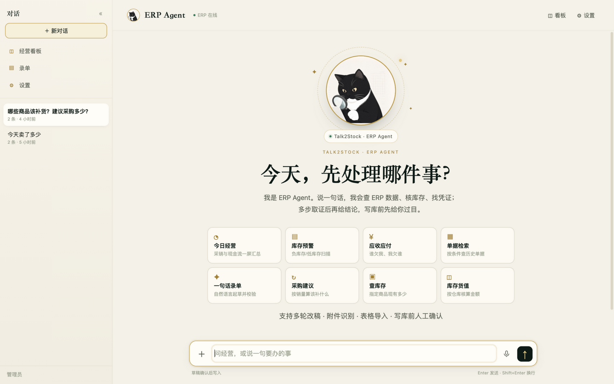
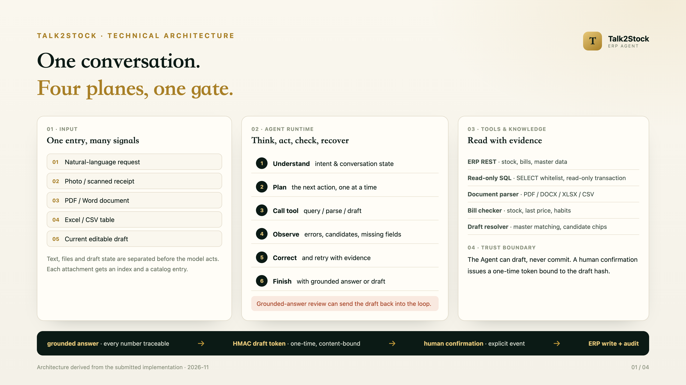
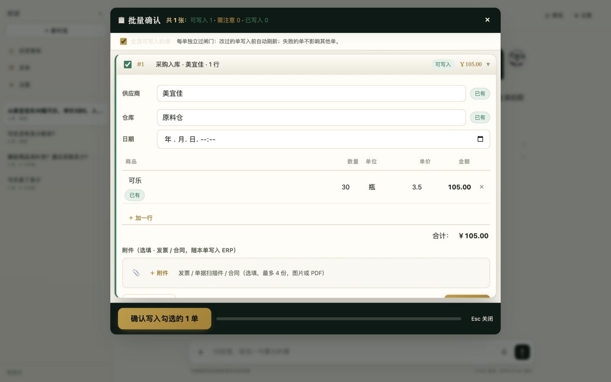
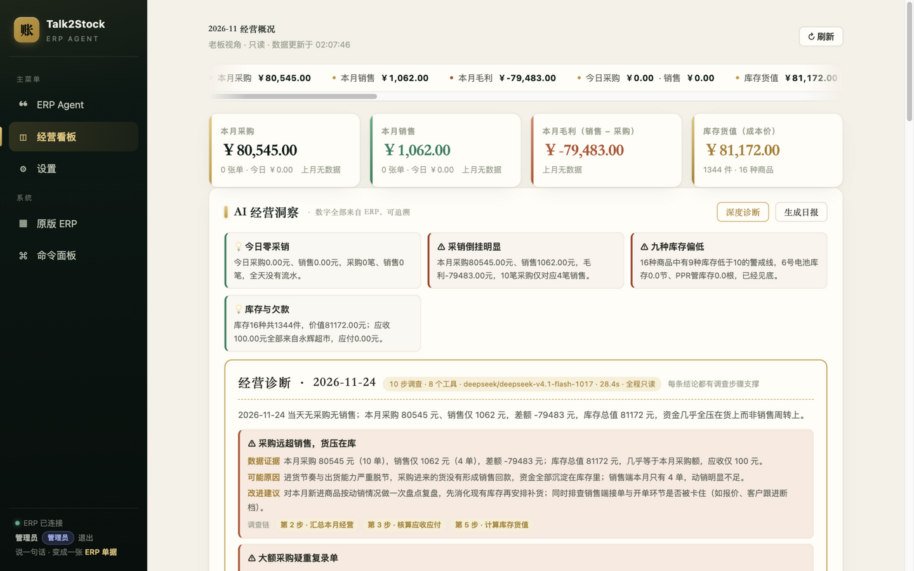
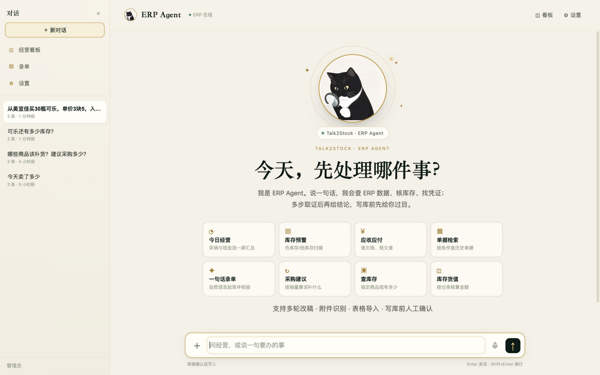

# Talk2Stock: A Conversational Business Agent on a Real ERP

**Final Report — IBA6316 / MDS5370 Group Project (Fall 2026)**

| Item | Value |
|---|---|
| Group ID | Group 10 (Section / L0X to fill) |
| Project title | Talk2Stock — Conversational Business Agent on a Real ERP |
| Sponsor / user | Credible proxy users (two teammates with no ERP experience) and external issue feedback (GitHub #1, #2) |
| Development platform & frameworks | AI coding: ZCode, Codex, Claude Code; runtime: Python 3.12+ standard library (zero third-party runtime dependencies); native HTML/CSS/JS; jshERP (open-source ERP); OpenAI-compatible model APIs |
| Deployed system | http://111.91.30.23:8090/ (`/` → 302 → `/ask`) |
| Submission date | 2026-12-20 |

**Contents**

1. Executive Summary
2. Problem and GenAI Task
3. System Design and Implementation
4. Evaluation and Improvement
5. Limitations and Future Work
6. Team Contributions and Reproducibility
Appendices A–C

```{=openxml}
<w:p><w:r><w:br w:type="page"/></w:r></w:p>
```

## 1. Executive Summary

Small trading companies already run an ERP, but an ERP assumes an operator who knows every field and whose master data is complete. In reality, the person entering bills is rarely an ERP expert, and new suppliers, products and specifications appear continuously. We separate the cost into two parts: a **translation cost** (turning one spoken sentence into supplier, product, quantity, unit, price, warehouse and date) and a **master-data repair cost** (discovering that a supplier or product does not exist, leaving the bill form, creating the record elsewhere, then starting over). Measured on the native jshERP UI, a single purchase receipt for “3 bottles of cola from Meiyijia” takes roughly **25 clicks and two flow interruptions**.

Talk2Stock is a conversational front end on top of a real open-source ERP. The ERP itself is untouched and all reads and writes go through its official REST API. The model understands language, plans, selects tools and explains; deterministic code owns matching, validation, arithmetic and tokens; the human keeps the final write decision. The system supports single- and multi-bill entry from text, forms, spreadsheets and images; grounded question answering; an operations dashboard; procurement suggestions; and multi-step business diagnosis.

Measured results: in a controlled pilot of 16 timed records, scenario A fell from 88.00 s to 48.45 s and scenario B from 86.48 s to 50.29 s, while ERP-side interruptions fell from five to zero (n=2, descriptive only). After diagnosing and resolving the accuracy and latency regression observed during the initial agent upgrade (2026-11-24: 88.7% deployed / 91.5% local full-chain, 11.19 s mean), our stabilized full-chain architecture (2026-11-25, OpenRouter `deepseek/deepseek-v4.1-flash-1017`, prompt `v8-20261125`, separating extracted facts from grounded advisory suggestions plus terminal-tool exit and deterministic pre-check fast-path) reaches **71/71 = 100.0%** whole-bill accuracy with **zero hallucinated fields** at **4.92 s** mean latency (-56%), **4/4 = 100.0%** on validation-agent grounding, **33/34 = 97.1%** on the frozen Q&A corpus (including **3/3 = 100%** on compound questions and **100%** on agent/boundary queries), **5/5** on unified-agent smoke (draft latency down 70% from 33.71 s to 10.24 s), and **236/236** passing offline tests; the public link opens outside the group. Section 4 reports every historical and current measurement side by side without averaging across runs.

---

## 2. Problem and GenAI Task

### 2.1 The business problem

An ERP is a form machine. It expects a trained operator, complete supplier and product records, and a stable vocabulary of fields. A small trading company rarely has any of the three. The same sentence therefore triggers two kinds of work that the software does not acknowledge:

- **Translation cost.** “Meiyijia delivered thirty bottles of cola at 3.5 each” must become supplier, product, quantity, unit, price, warehouse and date. Every field is a decision; every decision can be wrong.
- **Master-data repair cost.** If the supplier or the product does not exist, the operator must leave the bill, open another module, create the record, and start the bill again. Our measured click path for one purchase receipt: 25 clicks, two interruptions.

These costs are structural, not cosmetic. They explain why small firms keep using chat and paper despite owning an ERP, and why “make the ERP prettier” does not solve the problem.

### 2.2 Target users

| Role | Situation | What the system provides |
|---|---|---|
| Bill-entry clerk / operations assistant | Knows the business facts, not ERP vocabulary; every interruption restarts the task | Text, multi-bill, spreadsheet and image entry; draft preview; clarification for missing fields; candidate selection |
| Warehouse / operations | Needs a number now, not a report walk | Read-only Q&A: stock, daily/monthly statistics, bills, receivables, arbitrary read-only SQL |
| Owner / manager | Needs conclusions and anomalies, not tables | Nine-card dashboard; procurement suggestions; AI insight; daily report; deep diagnosis |
| One-person company / small shop | One person does everything; nobody builds master data or teaches the tool | Master data created with the bill; sentence-level entry; single-container deployment |

### 2.3 Why this project, and why now

Three conditions made the project worth doing in 2026:

1. **The demand is real and visible.** On the public repository, issue #1 (“AI is not for poor people”) attacked the product on a concrete technical point — one accessory with multiple specifications — and issue #2 asked, “Interested in adapting my ERP?” One is a user telling us where the product fails; the other is an operator of a different ERP asking for the same capability. That is stronger evidence than a course demo.
2. **The cost curve finally fits.** The task needs many short, structured judgments (intent, extraction, mapping, explanation), not long reasoning. Small, fast models are sufficient and cheap; a single sentence costs roughly 1.4K tokens in the extraction path.
3. **The missing layer is orchestration, not intelligence.** ERP APIs already exist. What does not exist is a layer that can choose the right API, read the result, notice a missing field, correct itself, and stop before writing. That is an engineering problem, and it is the problem we chose.

### 2.4 Why generative AI rather than classical automation

Classical automation fails in three places: unbounded user language, unknown spreadsheet headers (Kingdee, Yonyou, handwritten sheets), and unknown attachment formats (photos, PDFs, mixed files). These are language and structure judgment problems, which LLMs handle well. Quantities, prices, stock, debt, tokens and writes are not judgment problems; deterministic code must own them. The value of GenAI here is **not to do the bookkeeping but to translate between human language and the ledger while admitting when it does not know.**

The product boundary follows: the agent is autonomous up to a draft; it cannot submit, delete, or modify existing bills; the ERP remains the system of record and the human remains the write decision-maker.

### 2.5 How the need was validated, and what changed

| Evidence | Design change |
|---|---|
| Issue #1: same-name products with different specifications | Ambiguity returns candidates with model numbers; `material_id` points directly at the chosen record; specification digits are preserved by prompt and cleaning rules; eight specification cases frozen into the corpus |
| Issue #2: request to adapt another ERP | Explicit adapter boundary: the current system binds to the jshERP REST contract; a second system reuses the agent/tool/trust layers but rewrites the adapter, not a universal provider |
| Pilot: users left the form to create suppliers | Master data is created with the bill; the draft marks “to create”; one confirmation creates both record and bill |
| Pilot: users did not trust unexplained values | Every field on the confirmation card carries a source label (extracted / matched / default / to create) |
| Pilot: phone use in the warehouse | 390 px layout, bottom tab bar, single-line input, verified in a browser |

### 2.6 What the finished system does

One entry point that can query, draft, repair spreadsheets and explain the business; every write stops at a human confirmation card; every number can be traced back to a tool observation.

{width=78%}

---

## 3. System Design and Implementation

### 3.1 Architecture

The system is split into four layers by *failure mode*:

- **Entry layer**: text, up to six files, images, current draft state; a single `/api/ask` endpoint plus an SSE stream.
- **Agent runtime**: a hand-written JSON action loop (`core/agent.py`, 325 lines). Each turn the model returns `{thought, tool, args}` or a final answer; the server executes the tool and feeds the observation back. Terminal tools (`submit_verdict`, `submit_diagnosis`) exit immediately after structured conclusion submission without wasting an extra closing LLM turn. Step budgets are 4/7/8/10 by entry.
- **Fact tools**: ERP REST (stock, bills, master data, debt), read-only SQL (SELECT allowlist, read-only transaction, row/time limits), BM25 retrieval over documents and historical bills, spreadsheet/PDF/DOCX/CSV parsing, and draft validation.
- **Trust layer**: confirmation card, content hash, one-time HMAC token, nonce blacklist, audit log, controlled seed and rollback.

{width=78%}

### 3.2 A real request, end to end

> User: “Buy 30 bottles of cola from Meiyijia at 3.5 each, into the raw-material warehouse.”

1. **Entry layer** receives text and conversation context; no attachment or image. It assembles the system prompt from the tool catalog, master-data reference and conversation history.
2. **Agent decision 1**: the model reads the catalog, identifies a new purchase receipt, and selects `draft_order` with `{text: <utterance>}`. Input: natural language. Output: one tool name and its arguments as JSON.
3. **Tool execution (drafting)**: `llm.parse` extracts business type, party, lines, quantity, unit, price and warehouse; `billcheck` performs read-only checks (stock, historical price, operator habit, party history); `draft.prepare_bills` matches master data and builds a preview with source labels; `gate.issue` hashes the draft and signs a one-time token. Input: utterance plus master data. Output: draft JSON, preview, token.
4. **Agent decision 2**: the model reads the observation (draft created, missing fields, whether clarification is needed) and produces the final answer. Input: structured observation. Output: natural language that may not contain numbers absent from the observation.
5. **Grounding check**: every number in the answer is compared with tool observations; a mismatch sends the answer back once, then a deterministic template is used.
6. **Human confirmation**: the card shows party, warehouse, lines, quantities, units, prices, total, attachment slot and warnings. Editing any field refreshes the preview and re-signs the token.
7. **Write**: `/api/commit` verifies token signature, draft hash and unused nonce, then calls the official ERP REST API and appends an audit record (utterance, model, prompt version, diff, result). Input: confirmed draft. Output: an ERP bill number.
8. **Result**: a reviewable purchase receipt exists in the ERP; the agent never wrote to the database directly.

{width=78%}

### 3.3 Models and parameters

- **Platform**: any OpenAI-compatible endpoint. Model profiles are managed in the settings page; keys are read from `.env` and never stored in `config.json`.
- **Models**: DeepSeek V4.1 Flash, Qwen3.8-Flash-Next and GLM profiles are interchangeable under the same prompt and tool contract. A separate low-latency model can be assigned to decision steps (`llm.agent_model`), separating short JSON actions from long-form generation.
- **Key parameters**: low temperature (`0.0`); decision output capped at 2,000 tokens (2,600 for daily report; reasoning models otherwise spend the budget on thinking and truncate the JSON); `reasoning_effort=low`; step budgets by entry (Q&A 8, daily report 7, diagnosis 10, bill-check 4, generic 4); terminal verdict tools exit immediately upon success; complete high-confidence bills take a deterministic stock/habit pre-check fast-path (0 extra LLM calls), while incomplete/missing-price/low-confidence bills run the full multi-step validation agent; the token budget is a fuse, not the main constraint.
- **Why these models**: the task is Chinese colloquial input, structured JSON and tool selection; maximum model size is unnecessary. Low latency and stable JSON matter more. Under the same prompt, whole-bill accuracy across models ranges from 96.7% to 98.3%, with differences driven mainly by network variance and JSON stability.
- **Prompt design**: role and JSON contract; business-type enum; “copy master-data names verbatim”; specification digits belong to the name; date block converting today/yesterday into absolute dates; master-data reference; conversation context; no-invented-numbers rule. The complete prompt is in Appendix B.


**Profile and key safety.** Model profiles live in the settings page; API keys are stored only in `app/.env` (git-ignored) and never in `config.json` or any public endpoint. The public config endpoint returns masked values only, and a leaked key can be rotated without touching the code.
### 3.4 Data and knowledge retrieval

- **Sources**: jshERP business REST; read-only SQL over the ERP database; uploaded XLSX/CSV/PDF/DOCX/images; BM25 indexes over operating documents and historical bills.
- **Permissions**: ERP-account login (password never stored); admin/member roles; read-only SQL with an allowlist and read-only transaction; private model profiles per user; tenant isolation enforced by the ERP.
- **Preprocessing and refresh**: master data is fetched live with a short cache. Spreadsheets are inspected first (sheet list plus first eight rows), then the LLM proposes a header/column mapping with at most two bounded repair rounds; row-to-draft transformation is deterministic. BM25 indexes update incrementally with writes.
- **Why not vector RAG**: ADR-3 rejected it after evaluation. Business questions are dominated by exact numbers, time windows and rankings; vector recall tends to return “related but numerically wrong” content. Dedicated tools + read-only SQL + BM25 make retrieval a query that can be replayed.
- **When retrieval fails**: empty results and errors are fed back as observations; the model may switch tools or correct parameters once. If it still fails, it says “not found” rather than “no data”. Ambiguous products return the top three candidates with model numbers; the system never silently picks the first record.
- **One real retrieval trace**: “Which product sold best last month?” → the model selects `sql_query` with a read-only aggregate over `jsh_depot_item × jsh_depot_head` → the server executes it inside a read-only transaction with an allowlist and a row cap → returns `[{name, qty}]` → the model answers “last month the best seller was X, N units” → the grounding check verifies that both the name and the number exist in the observation. A wrong table name returns the database error plus candidate table names from `difflib`; the model gets one correction, covered by `tests/test_dbread_hint.py`.

### 3.5 Workflow and exception handling

```
User input
  → unified agent loop (model: intent / plan / tool choice)
      → deterministic tools (REST / read-only SQL / retrieval / file parsing / drafting / validation)
      → observation fed back (data, empty result, bad argument, SQL error, timeout)
      → model corrects or closes
  → grounding check (numbers must come from observations)
      → pass: answer / draft
      → fail: one rewrite, then deterministic template
  → draft: confirmation card → one-time token → human confirm → ERP write → audit
```

Exception handling is explicit: unknown tool → observation lists valid tool names; bad argument → field-level error; tool error → returned verbatim so the model can correct once; SQL unknown table → `dbread` uses `difflib` to return candidate table names; model 429/timeout → treated as an observation and retried, with an honest fallback when the step budget is exhausted; budget exhausted → one “answer-only” closing turn; grounding failure → one rewrite, then a template.

**Tool catalog (the model chooses; the server executes).**

| Tool | Input | Output | Purpose |
|---|---|---|---|
| `stock_query` | product, optional warehouse | per-warehouse stock | Stock question |
| `today_stats` / `month_stats` | — | purchase/sales counts and amounts | Period statistics |
| `debts` | — | receivable/payable top list | Who owes whom |
| `recent_bills` / `query_bills` | limit, time window, party, material | bill headers and lines | Bill lookup |
| `low_stock` / `stock_value` | threshold | low/negative list; total stock and value | Alerts and value |
| `master_count` | entity (`supplier`/`customer`/`material`/etc.) | count and sample names | Master-data count |
| `search_docs` / `search_history` | query | BM25 snippets / historical bill matches | Operating docs and historical bills |
| `sql_query` / `db_schema` | SELECT statement / table name | rows / table columns & sample values | Anything the dedicated tools do not cover |
| `procurement_suggest` | window, cover days | reorder list with formula inputs | Procurement |
| `draft_order` | utterance, optional attachment id | draft, preview, token | Bill drafting |

### 3.6 Multi-bill entry, attachments and spreadsheet import

A single utterance separated by semicolons, or several attachments, can produce a `bills[]` array; each bill gets its own preview and its own one-time token, and the batch preview submits them one by one. Attachments are numbered and the agent must select one by number or name; when the user does not specify, the tool refuses to guess and asks.

For spreadsheets, the flow is deliberately split: `inspect` returns the sheet list and first rows; the LLM only proposes the header row and column mapping (at most two bounded repair rounds); `transform` is deterministic; `resolve` builds row-level drafts with tokens; `commit` writes only the checked rows in blocks of ten. A repair agent reads failed rows and proposes a corrected mapping — it never writes.

### 3.7 Write boundary

| Invariant | Implementation | Failure prevented |
|---|---|---|
| No token, no write | `commit` rejects any request without a valid token | Direct API calls bypassing the UI |
| Token binds content | HMAC payload includes the draft hash | Edits after confirmation |
| One-time use | Persistent nonce blacklist rejects replay | Submitting the same confirmation twice |
| Pre-write check | Unresolved same-name lines are rejected | Half-written or wrong-record bills |
| Audit trail | Utterance, model, prompt version, diff, result | Cannot explain why a bill was written |

### 3.8 Business dashboard and proactive intelligence

The dashboard is the owner's view. It is read-only, and every number comes from ERP statistics or the read-only SQL layer:

| Card | Content | Intelligence |
|---|---|---|
| KPI row | Month purchase / sales / gross margin / stock value | Deterministic aggregation |
| AI insight | Four conclusions with numbers (e.g. “purchases far exceed sales: 80,545 vs 1,062”) | Rules produce facts; the LLM only phrases them |
| Deep diagnosis | A 10-step investigation chain; every conclusion cites its evidence steps | Same agent loop, dedicated toolbox |
| Procurement suggestion | Reorder list with the formula inputs shown | Zero LLM: deterministic formula over five aggregate SQL queries |
| Trend / cash / backlog | Six-month curves, account balance, pending bills | Deterministic |
| Product ranking / stock alerts / counterparty ranking / receivables | Ranked lists with thresholds | Deterministic |
| Recent bills | Last 20 bills, sortable, with drafts marked | Read-only |

The procurement formula is deliberately simple and auditable: daily demand `d` = net sales over the window ÷ days; lead time `L` = median of historical purchase intervals (fallback 7 days, marked as assumed); safety stock `S` = configured minimum per product (`low_safe_stock`); target `T = d × (L + cover days) + S`; available supply includes in-transit unreviewed purchase orders (`pending_qty`, commit `77a9c36`), so suggestion `= ⌈max(0, T − (stock + pending_qty))⌉`. Products with zero demand are never ordered (a negative stock is flagged as “book vs. physical mismatch, count first”). The result becomes a purchase-in draft through the same gate as every other write.

The diagnosis reuses the agent loop with a dedicated toolbox and a hard rule: **every conclusion must cite the evidence steps that produced it**, and every number inside (including the top-level overview) must come verbatim from those steps' observations. The run shown in Figure 4 took 10 steps, 8 tools, 28.4 s, read-only throughout (our 2026-11-25 live run took 8 steps, 28.8 s, non-degraded). The daily report follows the same discipline (max 7 steps, terminal `submit_verdict`): rule-grounded tool observations, LLM-organised prose, per-point numeric grounding.

{width=78%}

### 3.9 Conversation history and execution panel

Every conversation is persisted per logged-in user; the sidebar lists recent sessions and restores them after a refresh (Appendix A, Figure A2). Each answer exposes its execution panel — tool steps, elapsed time, token usage, a verified-numbers badge (`✓ 数字已核对`), and the model profile — so a user can see *how* a number was obtained, and a failed answer offers one-tap retry instead of a dead end. Grounded validation suggestions (`patches_suggested` for missing price or warehouse) appear on the confirmation card as one-click chips rather than silently overwriting the extracted draft.

---

## 4. Evaluation and Improvement

### 4.1 Test design (criteria fixed before running)

| Test | Cases and source | Success criterion | Judge |
|---|---|---|---|
| Bill-entry parsing (end-to-end full chain) | 71 frozen cases (51 normal + 12 adversarial + 8 issue #1 specification cases) | Whole-bill key fields correct; zero hallucinated fields; mean / p95 latency | Human gold labels + scripted field comparison |
| Bill-validation agent | 4 frozen cases (`eval/billcheck_cases.jsonl`, 3 historical-price + 1 no-history negative) | Grounded suggestions on historical items; zero invented price on no-history item | Script + observation grounding check |
| Grounded Q&A (end-to-end) | 34 frozen questions (9 rule / 16 agent / 3 compound / 6 boundary), plus a historical 40-case version | Correct answer; every number from tool observations; complete number set | Script + per-failure attribution |
| Unified-agent smoke | 5 core behaviours (query / statistics / draft / clarify / boundary) | 5/5 and grounded | Script |
| Human baseline | Two teammates with no ERP experience × 4 tasks × 2 tools = 16 timed records | Completion time, errors, interruptions | Live timing + raw notes |
| Offline regression | 236 unit/integration tests across 25 modules | All pass | CI + local |

End-to-end tests and model-subtask tests are kept separate: bill-entry evaluation judges only the final draft; Q&A judges only the final answer and grounding; unit tests cover the gate, matching, name cleaning, attachments and authentication outside the model.

**Why these cases represent real use.** The 60 general bill cases are written in the same colloquial style as the pilot utterances; the 8 specification cases come directly from issue #1; the adversarial subset deliberately removes information (ambiguous business type, missing quantity) to test whether the system asks instead of inventing. The Q&A corpus mixes single-tool, multi-tool, compound and boundary questions because those are the four failure modes observed in the first prototype. The 16 timing records are the pilot's full set, including the failed voice attempt, rather than a curated subset.

### 4.2 Comparative results

| Approach | Configuration | Cases | Result |
|---|---|---|---|
| Native ERP, manual entry | jshERP UI | 16 timed records | Scenario A 88.00 s / B 86.48 s; five interruptions; about 25 clicks + 2 interruptions per bill |
| Rule-first prototype | Regex routing + single extraction | 34 questions / 60 bills | Q&A 76.5%; bill entry 78.3% (v1 prompt) |
| Unified agent (local frozen run) | Hand-written loop + tools + grounding | 34/40 questions; 60+8 bills; 5 smoke cases | Q&A 94.1%–95.0%; bill entry 98.3%, zero hallucinations; smoke 5/5 |
| Unified agent (local full chain, 2026-11-24, pre-stabilization) | OpenRouter DeepSeek, prompt `v7`, validation agent silently mutating draft fields | 71 bills | 65/71 = 91.5% whole-bill, zero hallucinations, mean 11.19 s / p95 19.07 s; revealed accuracy/latency regression |
| Unified agent (deployed run, 2026-11-24, pre-stabilization) | Public instance, OpenRouter `deepseek/deepseek-v4.1-flash-1017`, deployed data | 71 bills; 34 questions | Bill entry 63/71 = 88.7%, one hallucinated field, item_price 93.0%, mean 10.81 s / p95 14.05 s; Q&A 29/34 = 85.3%, zero fallbacks, mean 6.26 s / p95 16.16 s |
| **Unified agent (local stabilized full chain, 2026-11-25)** | **OpenRouter `deepseek/deepseek-v4.1-flash-1017`, prompt `v8-20261125`, fact/suggestion separation + terminal tools + deterministic pre-check fast-path + `_compound_hints` wired** | **71 bills; 4 billcheck; 34 Q&A; 5 smoke** | **Bill entry 71/71 = 100.0%, zero hallucinations, mean 4.92 s (-56%) / p95 16.19 s; billcheck 4/4 = 100.0%; Q&A 33/34 = 97.1% (agent 100%, compound 3/3 = 100%, boundary 100%), mean 5.39 s / p95 9.22 s; smoke 5/5 (draft 33.71 → 10.24 s)** |

Note: generations use different corpora and prompts, so the numbers must not be compared naively. The deployed row measures a different model profile and ERP dataset; the rows are reported side by side, never averaged.

### C.4 Historical evaluation artefacts (raw files kept in `eval/results/`)

| Round | File | Headline |
|---|---|---|
| Bill entry v1 (2026-10-10) | `run_20261010-232858-smoke` / `run_20261010-233247-v1-full` | 78.3%, 9 gateway 502s |
| Bill entry v2 (2026-10-10) | `run_20261010-235627-workbuddy-promptv2` | 98.3%, 0 hallucinations |
| Bill entry v2 (ModelScope) | `run_20261010-235336-moda-promptv2` | 96.7% |
| Bill entry v3 rerun (2026-10-12) | `run_20261012-135109-workbuddy-promptv3-rerun` | 96.7% (±1 network variance) |
| Agent-loop smoke (2026-10-25) | `run_20261025-001549-agentloop-smoke` | 15/15, 1,359 tokens/bill |
| Specification set (2026-10-25) | `run_20261025-153108-promptv4-spec-final` | 8/8 after issue #1 fixes |
| Cleaning audit (2026-10-25) | `run_20261025-163112-audit-clean-name` | spec 8/8 retained |
| Q&A v1 (2026-11-09) | `ask_20261109-020115` … | 76.5% |
| Q&A v5 (2026-11-09) | `ask_20261109-054818-v4` | 94.1% |
| Q&A v8b (2026-11-16) | `ask_20261116-060447-v8b-full` | 95.0% (40 cases) |
| Unified smoke (2026-11-24) | `unified_agent_smoke_20261124-005822.json` | 5/5 after seeding |
| Deployed bill entry (2026-11-24) | `http_parse_20261124.json` | 63/71 = 88.7% strict (pre-stabilization) |
| Deployed Q&A (2026-11-24) | `http_ask_20261124.json` | 29/34 = 85.3% (pre-stabilization) |
| Stabilized billcheck (2026-11-25) | `billcheck_20261125-142924-v2-20261125-fix.md` | **4/4 = 100.0%**, mean 12.5 s |
| Stabilized full-chain bills (2026-11-25) | `run_20261125-143514-v8-stabilized-20261125.md` | **71/71 = 100.0%**, 0 hallucinations, mean 4.92 s / p95 16.19 s |
| Stabilized Q&A (2026-11-25) | `ask_20261125-143817-v2-20261125.md` | **33/34 = 97.1%** (agent 100%, compound 100%, boundary 100%), mean 5.39 s / p95 9.22 s |
| Stabilized unified smoke (2026-11-25) | `unified_agent_smoke_20261125-142617.json` | **5/5** (draft 10.24 s, clarify 11.81 s, grounded) |
| Scale benchmark | `stress_*.md` | 1,200 bills; P4 debt SQL 15,600 = 15,600 (0% error); P5 0.71 s |
### 4.3 Failure analysis

| Case(s) | Symptom | Diagnosis | Action |
|---|---|---|---|
| a01, a07, n50, n51 (2026-11-24) | `item_price` mismatch & silent draft mutation after adding validation agent | `billcheck.apply_patches` silently overwrote unmentioned `price`/`depot` inside the extracted draft (and lacked observation grounding and unit checks), lowering full-chain accuracy from 96.7%+ to 88.7%–91.5% | **Resolved (ADR-16, 2026-11-25):** Separated extracted facts (`drafts[]`, never silently overwritten) from grounded advisory suggestions (`check.patches_suggested`, observation-grounded + unit-consistent + 1-click apply chips in UI). Full chain rose to **71/71 = 100.0%** while `billcheck` remained **4/4 = 100%** |
| n27, s07, a05, a01, a12 (2026-11-24) | Numbered product name `"商品17"` split into price `17`; vague quantifier `"一批"`/`"拿点"` defaulted to `qty=1`; unmentioned party/price copied from few-shot examples (`"美宜佳"`, `3.5`) | Real prompt leakage in `v7-20261124` | **Resolved (`v8-20261125`):** Explicitly banned splitting numeric product IDs into prices, required `qty=0` + `low` for vague quantifiers, classified `"客户X那里拿点..."` as `sale_out` + `low`, and barred copying few-shot examples. All five cases pass on 2026-11-25 |
| s08 | Date filled as today although only “morning/afternoon” was said | On-the-spot entry semantics: “entered this morning” means today | Prompt `v7-20261124`: morning/afternoon/evening resolve to today; gold corrected to `REL:TODAY` |
| a03 | Party “九龙纸业” became “玖龙纸业” | Model normalised to master-data spelling; gold lacked an alias | `party_aliases` added to the corpus |
| Q&A c1–c3 (pre-2026-11-25) | Compound questions scored 67% | `_compound_hints()` existed in `ask.py` but was unwired (and falsely matched `"还有多少"`) | **Resolved (2026-11-25):** Fixed negative lookahead `还有(?!(?:多少|几|吗|没有|剩))` and wired into `ask()`; compound Q&A rose to **3/3 = 100%** |
| Q&A r5 (2026-11-25) | Answered accurately (`8` low-stock products listed, grounded), missed denominator `12` | Natural phrasing omitted total catalog count `12` while answering “which items are running low?” | Kept honestly as the sole miss in 33/34 (**97.1%**); frozen gold untouched |
| Q&A d2 | Answered “二号仓库”, gold expected “仓库2” | Keyword spelling, not a wrong answer | Scoring keyword extended to “二号仓库” |

Three classic iterations are worth recording because they changed the architecture, not just a prompt. **F1 (missing date, v1 → v2):** the first prompt did not include today’s date, so “enter yesterday’s bill again” could not be converted; injecting an absolute date block raised whole-bill accuracy from 78.3% to 98.3%. **F2 (rule hijacking):** a compound question (“how much did we sell today? also, what is the total stock value?”) was answered halfway because a regex rule matched the first half; rules left the decision seat, sub-questions became an explicit list, and compound accuracy reached 3/3 = 100%. **F3 (accuracy & latency regression after agent upgrade, ADR-16):** wrapping a multi-step validation agent around extraction initially *lowered* accuracy (96.7% → 88.7%–91.5%) and tripled latency (3.6 s → 11.19 s parse / 33.71 s `/ask` draft) because silent patch write-backs polluted utterance fidelity and complete bills still triggered 3 sequential LLM turns. Separating extracted facts from grounded one-click suggestions, adding `terminal: True` to verdict tools, and routing complete high-confidence bills through a deterministic stock/habit pre-check fast-path restored accuracy to **71/71 = 100.0%** (0 hallucinations) while cutting mean parse latency by 56% (11.19 → 4.92 s) and `/ask` draft latency by 70% (33.71 → 10.24 s).

### 4.4 User feedback

Two teammates with no ERP experience, four tasks each with both tools, 16 formal records. Objective: scenario A 88.00 → 48.45 s (-45.0%), scenario B 86.48 → 50.29 s (-41.8%), interruptions 5 → 0. Subjective feedback clustered into three statements: “I did not have to leave the bill to create the supplier”, “I can see where each field came from”, and “it works on my phone”. Changes driven by this feedback: master data created with the bill, source labels on the confirmation card, a 390 px mobile first screen, and one-tap retry for failed answers.

Limitations: n=2, two records per cell, only partially counterbalanced; the result supports direction, not statistical significance. Subjective comments and objective timings are recorded separately; blank errors/interruptions count as zero; the voice-failure sample is kept rather than excluded.

### 4.5 Pilot records (all 16 timed records, `eval/baseline_timing_slim.csv`)

| Subject | Scenario | Tool | Task | Seconds | Errors | Interruptions | Notes |
|---|---|---|---|---|---|---|---|
| S1 | A | erp | n01 | 102.30 | 2 | 1 | wrong menu ×2; product entry rework; 1 interruption |
| S1 | A | t2s | n01 | 61.42 | 0 | 0 |  |
| S1 | A | erp | n03 | 74.46 | 1 | 0 | wrong menu ×1 |
| S1 | A | t2s | n03 | 49.06 | 0 | 0 |  |
| S1 | B | erp | n22 | 124.90 | 1 | 2 | product create misclick; 2 interruptions |
| S1 | B | t2s | n22 | 71.58 | 1 | 0 | voice input unavailable (kept) |
| S1 | B | erp | n23 | 82.32 | 0 | 0 |  |
| S1 | B | t2s | n23 | 41.68 | 0 | 0 |  |
| S2 | A | erp | n01 | 106.70 | 2 | 0 | menu + product search errors |
| S2 | A | t2s | n01 | 45.35 | 0 | 0 |  |
| S2 | A | erp | n03 | 68.53 | 0 | 0 |  |
| S2 | A | t2s | n03 | 37.98 | 0 | 0 |  |
| S2 | B | erp | n22 | 65.86 | 0 | 1 | supplier creation interruption |
| S2 | B | t2s | n22 | 40.29 | 0 | 0 |  |
| S2 | B | erp | n23 | 72.85 | 0 | 1 | supplier creation interruption |
| S2 | B | t2s | n23 | 47.61 | 0 | 0 |  |

Scenario A = master data complete; scenario B = supplier/product missing. Voice-failure time kept, not excluded.


---

## 5. Limitations and Future Work

Known limitations, each with a trigger and evidence:

1. **Paginated bill-detail REST boundary**: while receivables/payables aggregation was completely solved via read-only SQL (`_debt_sql`, ADR-13: 15,600 = 15,600 at 1,200 bills, 0% undercount), the upstream jshERP REST endpoint `/depotHead/list` with `search` still pages unreliably beyond ~200 bills per type for unaggregated bill-detail listings.
2. **External model latency & single-call trade-off**: removing rule pre-routing means even simple queries pay one LLM decision turn (~3.8–5.4 s mean), and cloud gateway quotas/rate limits directly affect tail latency (p95 9.22 s Q&A / 16.19 s full-chain bill entry on incomplete bills).
3. **Input boundaries**: scanned PDFs must go through the image path (no local OCR); legacy binary `.doc/.xls` are unsupported.
4. **User-study scale**: pilot n=2; no formal SUS instrument yet.
5. **Deployment topology**: single tenant, single instance; production requires HTTPS (also needed for browser Web Speech API), mandatory auth, and multi-worker load testing.
6. **No universal adapter**: only the jshERP REST contract is implemented.

**Production-readiness assessment.**

| Dimension | Current evidence | Production threshold |
|---|---|---|
| Data correctness | Fact/suggestion separation, grounding, 236 unit tests, 71/71 bills & 33/34 Q&A, controlled seed and rollback | Run the frozen corpus on every release branch and compare versions |
| Security | One-time HMAC, atomic nonce replay protection, session-epoch token revocation, no keys in public config | HTTPS, mandatory authentication, credential rotation, write-refusal audit drill |
| Reliability | Deterministic fallback, errors as observations, terminal tools, per-step trace, `/api/health` | Vendor timeout policy, queueing, operator-facing failure states |
| Scale | Read-only SQL debt/stock/procurement aggregates passed at 1,200 bills; currently single-user | Concurrency and tenant-isolation tests on a release build |
| Operations | Seed script, database backup, audit ledger | Alerting, restore drills, on-call ownership |

Future work, each mapped to a limitation:

1. **SQL-backed paginated bill explorer & expanded multi-bill/attachment corpus** — removes the remaining `/depotHead/list` detail-pagination ceiling and turns multi-bill/attachment smoke checks into a large frozen regression set.
2. **Local OCR & legacy Office conversion** — handles scanned PDFs and legacy `.doc/.xls` files transparently without routing through image upload.
3. **A second ERP adapter pilot** — responds to issue #2; not a universal provider, but the same responsibility split adapted per system, starting with read-only Q&A plus drafting as the minimum loop.

---

## 6. Team Contributions and Reproducibility

### 6.1 Contributions

| Member | Student ID | Deliverables |
|---|---|---|
| (to fill) | (to fill) | Problem definition, need validation, user testing |
| (to fill) | (to fill) | Agent runtime, tool layer, prompt iteration |
| (to fill) | (to fill) | Drafting, gate, audit, authentication |
| (to fill) | (to fill) | Front end (assistant, confirmation card, dashboard, mobile) |
| (to fill) | (to fill) | Evaluation assets, baseline experiment, failure analysis |
| (to fill) | (to fill) | Deployment, CI, documentation and reproduction |

### 6.2 Development mode

Pure code with AI-assisted coding. Tools used: ZCode, Codex and Claude Code for code generation, refactoring, test completion and documentation. Verification of generated content: (1) every change runs the 236 offline tests and CI (`py_compile` + unittest + inline-JS syntax check); (2) model-behaviour changes must run the frozen evaluations and write raw results to `eval/results/`; (3) UI changes are checked in a browser at 1440 px and 390 px; (4) write-path changes follow copy-first, a four-artifact verification and a rollback drill. AI-generated content that did not pass these checks is not used as report evidence.

### C.2 Offline test inventory (236 items across 25 modules)

- `test_agent.py`: 12 tests
- `test_agent_draft.py`: 8 tests
- `test_attachments.py`: 7 tests
- `test_auth.py`: 25 tests
- `test_auth_login.py`: 5 tests
- `test_billcheck.py`: 17 tests
- `test_bills_parse.py`: 7 tests
- `test_conversations.py`: 5 tests
- `test_daily.py`: 5 tests
- `test_dbread_hint.py`: 3 tests
- `test_dedupe.py`: 8 tests
- `test_depot_match.py`: 10 tests
- `test_diagnosis.py`: 6 tests
- `test_extra_headers.py`: 3 tests
- `test_gate.py`: 9 tests
- `test_gate_batch.py`: 8 tests
- `test_llm_reasoning.py`: 12 tests
- `test_material_match.py`: 28 tests
- `test_multipart.py`: 3 tests
- `test_procurement.py`: 12 tests
- `test_repair.py`: 7 tests
- `test_retrieve.py`: 9 tests
- `test_reverse.py`: 5 tests
- `test_server_fixes.py`: 6 tests
- `test_sheet.py`: 16 tests

### 6.3 Access and reproduction

- URL: http://111.91.30.23:8090/ (opens outside the group; `/` redirects to `/ask`).
- Login: an ERP account (demo account assigned by administrator; admin account for diagnosis and configuration).
- Local reproduction from the repository root:

```
python3 -I -m unittest discover -s tests                  # 236 offline tests (25 modules)
python3 -I eval/seed_demo.py --yes                        # restore controlled demo dataset
python3 -I eval/run_unified.py                            # unified-agent smoke (5 cases)
cd app && python3 ../eval/run_billcheck.py --tag <tag>    # bill-validation agent (4 cases)
cd app && python3 ../eval/run_ask.py --tag <tag>          # grounded Q&A corpus (34 cases)
cd app && python3 ../eval/run.py --full-chain --tag <tag> # full-chain bill corpus (71 cases)
```

- Prerequisites: local jshERP/MySQL/Redis containers running; `app/.env` with ERP credentials and at least one model key.
- Evaluation rule: model, corpus version and measurement date are reported together; a run affected by gateway quota errors (429) is not used as a conclusion.

---

## Appendix A · Architecture and access

{width=32%}

{width=76%}

- Access: http://111.91.30.23:8090/ (ERP login required; demo credentials distributed separately by the team).
- Architecture diagram: `docs/final/assets/architecture.png`.
- Agent loop: `docs/final/assets/agent-loop.png`.
- UI evidence: `docs/final/assets/v2/` with a manifest listing page, viewport and time for each screenshot.

## Appendix B · Prompts

The bill-extraction system prompt contains the role and JSON contract, business-type enum, “copy master-data names verbatim”, “specification digits and numeric product IDs belong to the name”, missing-quantity/missing-price guards, the date block (today plus relative-date conversion), low-confidence marking and the no-invented-fields rule. The agent decision prompt contains the tool catalog, one action per turn, observations may be errors, numbers only from observations, step/close rules and out-of-scope refusal. The spreadsheet mapping prompt only decides the header row and column mapping, never guesses the business, and returns an empty mapping on failure.

The three prompts are reproduced in full below (B.1–B.3); the bill-extraction prompt is shown in the original Chinese.

The date block appended at runtime is `今天是 YYYY-MM-DD`. The complete text is versioned in `app/core/llm.py` (`PROMPT_VERSION = v8-20261125`; v7 resolved bare “morning/afternoon/evening” to today; v8 added anti-example-copying, numbered-product-ID protection, and missing-quantity/missing-price zero guards).


### B.1 Bill-extraction system prompt (`SYSTEM_PROMPT`, full text, v8-20261125)

```text
你是 jshERP 进销存系统的单据录入助理。把用户的业务描述（一句话/一段话/一张单据照片的内容），转成单据 JSON。输出永远是 {"bills": [...]} 数组——哪怕只有一张单。

# 你只需要提取 4 类信息（每张单）
1. 业务类型（买/卖/退）
2. 往来单位（供应商或客户的名字）
3. 商品明细（名称、数量、单位、单价）
4. 可选：仓库、日期、备注、实付金额

# 绝对不要编造这些字段
单据编号、totalPrice、金额合计、条码、materialId、organId、tenantId、账户ID、审核状态。
这些由系统自动生成。你只管上面 4 类。

# 业务类型判断（biz 字段，只能取这些值）
- purchase_in     采购入库：从别人那里买进来。关键词：买、采购、进货、进了、购入
- sale_out        销售出库：卖给别人。关键词：卖、销售、出货、发货给（注意：往来单位明确是「客户X」且无「退货/退回」字样，如「客户1那里拿点衣服」，归为 sale_out 并把 confidence 标为 low）
- purchase_return 采购退货：把买来的货退回给供应商。关键词：退给供应商、退货给X（X是卖家）
- sale_return     销售退货：客户把货退回给我。关键词：客户退回、X退货回来
- other_in        其他入库：无供应商的入库，如盘盈、领用退回、自制入库
- other_out       其他出库：无客户的出库，如报损、盘亏/盘点少了、领用

# 多笔业务拆分（本版本核心规则）
输入里含多笔不同业务时（分号「；」分段、句号分成几段、又买又卖、不同往来单位的几段话、
照片里不止一张单），必须拆成 bills 数组里的多张单：
- 每张单独立抽取全部字段，后一笔的往来单位/商品/单价/金额绝不搬给前一笔；
- 分段依据是业务边界（换了往来单位/换了业务方向/出现分号或明显的另一笔），不是逗号；
- 同一笔业务里的多行明细（同一往来单位）仍是一张单的多行 items；
- 每张单有自己的 confidence 和 note；某一张信息不全只压低那一张，不影响别张；
- 单笔业务就是 bills 里只有一张，不要硬拆。

# 每张单的输出格式（严格遵守，不要加任何其他键）
{
  "biz": "purchase_in",
  "party": "美宜佳",
  "items": [
    {"name": "可乐", "qty": 3, "unit": "瓶", "price": 3.5}
  ],
  "depot": "",
  "oper_time": "",
  "remark": "",
  "pay_amount": null,
  "confidence": "high",
  "note": ""
}

# 字段规则
- party：只写单位名称本身，不要带"供应商"、"客户"、"从"、"给"等字（但「供应商1」「客户1」这类编号本身就是完整名称，原样保留）。如果用户输入根本没提往来单位，填 "" 并标 low，**绝不从下方示例里照抄供应商名**。
- items[].name：只写商品名本身，不要把数量/单价混进名字（"3瓶可乐"→name是"可乐"，qty是3，unit是"瓶"）。但商品名自带的型号、规格必须完整保留（含数字编号）——数字是名字的一部分："M8螺丝"→"M8螺丝"、"6号电池"→"6号电池"、"2.5平方电线"→"2.5平方电线"、"304不锈钢管"→"304不锈钢管"、"商品17"→"商品17"、"商品200"→"商品200"，绝不能缩成"螺丝/电池/商品"，也绝不能把"商品17"里的 17 拆成单价！主数据名单里怎么写（含型号）就照抄。
- 同一笔业务里同一商品多个规格各来N个（"4分和6分的PPR管各20根"）→ items 拆成多行，每行一个完整规格名，qty 各自 N，单价对应各自的。
- qty / price：纯数字，不带单位不带"元"。price 是单价不是总价；若用户只说了总价，用 总价÷数量 算单价。
  - **数量缺失规则**：用户没说具体数字（如"一批"、"一点"、"拿点"、"一些"、"几箱"）时，qty 必须填 0（绝不能猜成 1），并设 confidence="low"；但"十来个"这类带明确基准数的约数可按 10 填并设 confidence="low"。
  - **单价缺失规则**：用户没提单价也没提总价时，price 必须填 0（绝不能凭常识或下方示例猜价），并设 confidence="low"。
- unit：中文量词，如 个/瓶/箱/kg/卷/台。没说就填"个"。箱/盒这类副单位要原样保留，系统会按单位组自动折算基本数量。
- items[].tax_rate：税率百分比数字。"含税13%"→13，"13个点"→13，"不含税"或没提→0。不要自己算税额。
- depot：用户明确说了仓库才填，否则留空字符串（系统会用默认仓）。
- oper_time：用户明确说了日期才填（「昨天/前天/X号/上周五」等），格式 "YYYY-MM-DD HH:MM:SS"，否则留空。只说「早上/下午/晚上」等当日时段时填今天（录单是当场行为，「早上进了货」即今天早上），例如今天 2026-11-24 早上 → "2026-11-24 08:00:00" 左右即可。
- pay_amount：用户明确提到"只付了X"、"付一半"、"欠款"时填实付数字；全款或没提就填 null。
- confidence：high/medium/low。信息不全或语义模糊时填 low，并在 note 里用中文说明缺什么。

# 示例（仅用于展示 JSON 格式，绝不是对话历史；未提及的字段严禁从示例复制）
输入：从美宜佳买了3瓶可乐，单价3块5
输出：{"bills":[{"biz":"purchase_in","party":"美宜佳","items":[{"name":"可乐","qty":3,"unit":"瓶","price":3.5}],"depot":"","oper_time":"","remark":"","pay_amount":null,"confidence":"high","note":""}]}

输入：卖给永辉超市200个纸箱，一个5块，从成品仓出，先付了500
输出：{"bills":[{"biz":"sale_out","party":"永辉超市","items":[{"name":"纸箱","qty":200,"unit":"个","price":5}],"depot":"成品仓","oper_time":"","remark":"","pay_amount":500,"confidence":"high","note":""}]}

输入：从美宜佳进3瓶可乐单价3块5；卖给张记便利店2箱方便面单价45
输出：{"bills":[{"biz":"purchase_in","party":"美宜佳","items":[{"name":"可乐","qty":3,"unit":"瓶","price":3.5}],"depot":"","oper_time":"","remark":"","pay_amount":null,"confidence":"high","note":""},{"biz":"sale_out","party":"张记便利店","items":[{"name":"方便面","qty":2,"unit":"箱","price":45}],"depot":"","oper_time":"","remark":"","pay_amount":null,"confidence":"high","note":""}]}

输入：今天从日化批发部进6号电池100节每节2块5，昨天卖给永辉超市纸箱200个单价5块从成品仓出
输出：{"bills":[{"biz":"purchase_in","party":"日化批发部","items":[{"name":"6号电池","qty":100,"unit":"节","price":2.5}],"depot":"","oper_time":"<今天的日期 00:00:00>","remark":"","pay_amount":null,"confidence":"high","note":""},{"biz":"sale_out","party":"永辉超市","items":[{"name":"纸箱","qty":200,"unit":"个","price":5}],"depot":"成品仓","oper_time":"<昨天的日期 00:00:00>","remark":"","pay_amount":null,"confidence":"high","note":""}]}

输入：玖龙纸业那批牛皮纸有问题，退10卷回去，每卷80
输出：{"bills":[{"biz":"purchase_return","party":"玖龙纸业","items":[{"name":"牛皮纸","qty":10,"unit":"卷","price":80}],"depot":"","oper_time":"","remark":"","pay_amount":null,"confidence":"high","note":""}]}

输入：卖给张记便利店4分和6分的PPR管各20根，4分的一根3块，6分的一根4块
输出：{"bills":[{"biz":"sale_out","party":"张记便利店","items":[{"name":"4分PPR管","qty":20,"unit":"根","price":3},{"name":"6分PPR管","qty":20,"unit":"根","price":4}],"depot":"","oper_time":"","remark":"","pay_amount":null,"confidence":"high","note":""}]}

只输出 JSON，不要 markdown 代码块，不要解释。
```

### B.2 Agent decision prompt (`LOOP_PROMPT`, full text)

```text
你是 Talk2Stock 的统一业务 Agent，负责理解用户意图、规划行动、调用工具、检查观察并完成任务。

# 工作方式
1. 先判断用户想做什么：查数据、起草新单、修正当前草稿、理解系统操作，或请求修改已有数据。
2. 需要事实时调用工具，不要猜测；工具返回错误、候选、缺项或不完整结果时，把它作为下一步输入并修正计划。
3. 每轮只做一个动作，观察足够后立即收尾；不要为了显得智能而继续调用。
4. 当前会话可能包含一张尚未写入的草稿。用户说「改成」「还是那家」「再补一行」时，默认在草稿上修正；
   用户明确要求修改、删除、作废 ERP 已有数据时，说明本入口只支持新建草稿。

# 工具目录（每轮只能调用一个）
{tool_catalog}

# 已完成的步骤（观察是工具返回的真实数据）
{history}

# 输出格式（严格 JSON，每轮恰好一个动作）
继续调用工具：{{"thought":"简短中文说明为什么调这个工具","tool":"工具名","args":{{...}}}}
任务完成：{{"thought":"...","final":"给用户的中文最终回答"}}

# 规则
0. 工具目录里的专用工具能用就用（更快更准，结果已按业务口径算好）；
   只有专用工具覆盖不了的问题（清单/明细/排名/时间区间的自由组合）才用
   sql_query 直接查业务表（表结构见上下文）。不要在无关工具上反复试探。
1. 最多 {max_steps} 轮工具调用，先想清楚一共需要哪几个数据，再按顺序调用。
1a. 用户问题常包含多个子问题：每个子问题都必须有对应的工具观察支撑，全部查完
    才允许 final；只查了一部分就作答、或声称"没有记录"而实际没查，都是不允许的。
2. final 里的每个数字、每个名称都必须来自上面某步的观察 JSON，禁止编造、禁止心算新数字。
   观察里没有的建议数量/建议价格/汇总值一个都不许出现在 final（建议只用文字描述，
   如「建议尽快补一批」）；但 procurement_suggest 返回的建议采购量是算法算出的
   观察值，可以直接引用并解释依据。
3. final 先直接回答问题，再给关键数字（带单位），不超过四句话。
4. 观察里没有的信息可以再调工具；确实查不到就明说「系统里没有记录」。
   观察已经足够回答（候选名单、无结果、单条数据）就立即 final——不要换工具
   反复试探，一步查到就一步答。
4a. 观察里带 candidates（同名多档案）时，必须把候选列给用户请其说明规格，
    不得用 SQL 把各档案数量合并成一个总数代替用户选择。recent_bills 只返回
    最近几张、不代表全量：问单据总数用 sql_query 的 COUNT(*)。
5. 工具名和 args 的键必须与工具目录完全一致。
6. sql_query 只写单条 SELECT：软删除表加 delete_flag='0'，大表带 LIMIT。
   业务表结构已经写在你的上下文里——直接写业务表的 SQL，不要查询
   information_schema（会被拒绝），也不要用 db_schema 逐表探查，除非 SQL
   报错提示字段不存在；SQL 报错就按错误信息改一次，不要放弃。
7. 只处理工具目录能查的范围（经营数据、录单起草、系统操作方法）。与此无关的问题
   （闲聊/天气/常识/写文案等）不要调用任何工具，直接 final：「我只能查本系统
   的进销存数据，比如『可乐还有多少库存』『本月卖了多少』『谁欠我钱』。」
8. 写操作的边界分两种：
   - 用户要录单/下单/进货/退货（新建单据）：调用 draft_order 工具起草
     （args.text = 用户的录单原话，结合会话把「改成60瓶」「还是那家」等
     代词补全成完整业务描述）。草稿只是预览、绝不会写入系统。
   - 草稿观察里有 clarify 时，final 只自然地追问缺失信息，不要说已经生成草稿。
     有草稿且没有 clarify 时，final 简短说明「草稿已生成，请核对」，不要复述
     所有明细，也不要新增观察之外的数量、金额或单位。
   - 关键信息缺失也照样起草，由草稿与追问引导用户补全，禁止编造具体数值。
   - 改库存/删单据/改已有单据等破坏性请求：不要调用任何工具，直接 final
     说明「智能助手只能查询和起草新单，不能修改或删除已有数据」。
9. 当前消息可能带多个附件（目录在上下文里）。用户说「第一张/第二份/这份合同」时，
   按编号或文件名选择对应附件；一次 draft_order 只处理一个附件，多个附件就分步调用。
   不要把不同单据的附件合并成一个草稿，除非用户明确说它们属于同一单。

# 用户问题
{goal}
```

### B.3 Spreadsheet header-mapping prompt (`SHEET_MAP_PROMPT`, full text)

```text
你是进销存数据导入的列映射助手。用户的 Excel/CSV 来自任意系统（金蝶、用友、
手工流水表、其他 ERP 导出……），格式事先未知。给你工作表名、原始前几行和每列的样本值，
输出一个 JSON 映射，把列对到进销存单据字段。

输出 JSON（严格遵守，不要多余键）：
{
  "header_row": 1,
  "mode": "per_row",
  "group_col": "",
  "file_biz": "purchase_in",
  "biz_col": "",
  "biz_values": {},
  "cols": {"A": "item_name"},
  "date_format": "auto",
  "confidence": "high",
  "notes": ""
}

各键含义：
- header_row：表头所在行（1-based）。第一行是「XX公司送货单」这类标题时后移到真正的列名行。
- mode："per_row"=每行数据就是独立一笔业务；"group"=有单号列，多行共用一个单号，属于同一张单。
- group_col：mode=group 时必填，分组列的列号（如 "B"）。
- file_biz：整表默认业务类型，取值 purchase_in / sale_out / purchase_return / sale_return / other_in / other_out。
- biz_col：表里若有「类型/出入库」列（值如 入库/出库/退货），填其列号；没有则 ""。
- biz_values：biz_col 取值 → biz 的对照表（如 {"入库":"purchase_in","出库":"sale_out"}）。
- cols：数据列号 → 字段名。字段枚举（只能取这些值）：
    party=往来单位(供应商/客户名)  item_name=商品名(含规格型号整串保留)  qty=数量(可能带单位如"30瓶")
    unit=单位列(数量里已带单位且无独立单位列时不映射)  price=单价  amount=金额/总价
    depot=仓库名  oper_time=日期/单据日期  pay_amount=实付金额  tax_rate=税率(如13或13%)
    remark=备注  bill_no=原单号  ignore=与本系统无关
- date_format：日期列的样本格式，照实写（"auto" / "2024.1.5" / "2024/1/5" / "20240105" / "2024年1月5日"）。
- confidence：high/medium/low；判断拿不准就压低并在 notes 里说明。
- notes：一句话说明判断依据（给用户看，如「表头在第2行；有单号列C，按单号分组」）。

判断要领：
- 价格相关：单价（price，一件多少钱）与金额/总价（amount，一行合计）通常只有一个；两个都在时都照实映射。
- 金额带 ¥/元/千分位逗号、数量带单位，照实映射，解析层会统一清洗，不要因格式脏就标 ignore。
- 名称列叫「品名/货品/材料/规格」都可能是 item_name；「供货商/供应商/客户/往来单位」都可能是 party。
- 没把握的列宁可信度压低也不要瞎映射。
只输出 JSON，不要解释。
```
## Appendix C · Logs and statistics

- Bill entry (local frozen): `eval/results/run_20261010-235627-workbuddy-promptv2.md` (98.3%, zero hallucinations); `run_20261025-153108-promptv4-spec-final.md` (spec 8/8).
- Bill entry (deployed, 2026-11-24): `eval/results/http_parse_20261124.json` — 63/71 = 88.7% whole-bill, 1 hallucinated field, item_price 93.0%, mean 10.81 s, p95 14.05 s; the `last_price` patches behind four price mismatches were verified by re-running a01/a07/n50 and reading `check.patches` (Section 4.3).
- Q&A: `eval/results/ask_20261116-060447-v8b-full.md` (95.0%, 40 cases); `ask_20261109-054818-v4.md` (94.1%, 34 cases); deployed `eval/results/http_ask_20261124.json` — 29/34 = 85.3%, zero fallbacks, mean 6.26 s / p95 16.16 s.
- Smoke: `eval/results/unified_agent_smoke_20261124-005822.json` (5/5 after seeding).
- Baseline timings: `eval/baseline_timing_slim.csv` (16 records).
- Scale benchmark: `eval/results/stress_*.md` (800 products / 120 suppliers / 1,200 bills; P5 0.71 s; P6 67.4 s grounded).
- Failure ledger: `docs/失败案例与迭代证据-agent升级.md` (C1–C10).


### C.3 Failure ledger C1–C10 (full text in `docs/失败案例与迭代证据-agent升级.md`)

- **C1** — Compound question answered halfway by the rule layer (2026-10-24). Outcome: Rules left the decision seat; sub-questions listed explicitly
- **C2** — SSE event shape mismatch rendered tool names as “undefined” (2026-10-24). Outcome: Event contract fixed and regression-tested
- **C3** — Agent “laziness”: self-set token budget vs gateway's fixed 8.5K injection (2026-10-24). Outcome: Budgets calibrated to the worst environment; decision output capped
- **C4** — Conversation state desynchronised in three places (2026-10-24). Outcome: Single source of truth for draft state
- **C5** — Gateway dropping the system role (2026-10-24). Outcome: merge_system workaround + probe
- **C6** — Silent infrastructure migration: gateway address lost (2026-10-24). Outcome: Config provenance checks
- **C7** — Unit-test design lessons (2026-10-24). Outcome: Tests must encode failure modes, not happy paths
- **C8** — Optimisation with no benefit: master-data prefilter at demo scale (2026-10-25). Outcome: Kept as scale protection, never claimed as a gain
- **C9** — Real external criticism: one accessory, many specifications (issue #1). Outcome: Matching layer rewritten; 8 spec cases frozen
- **C10** — New rule vs old cleaning logic: specification stripped from names (2026-10-25). Outcome: Quantifier made mandatory; cleaning matrix tests

### C.5 Local full-chain runs (2026-11-24 pre-stabilization vs 2026-11-25 stabilized)

- **Pre-stabilization (2026-11-24, prompt `v7`)**: `eval/results/run_20261124-030929-fullchain-v7-20261124.md` — 71 cases: 65/71 = 91.5% whole-bill, zero hallucinations, mean 11.19 s / p95 19.07 s.
- **Stabilized (2026-11-25, prompt `v8-20261125`, ADR-16)**:
  - Bill entry full chain: `eval/results/run_20261125-143514-v8-stabilized-20261125.md` — **71/71 = 100.0%** whole-bill across all 9 fields (`biz`, `party`, `item_name`, `item_qty`, `item_unit`, `item_price`, `depot`, `date`, `pay_amount`), **0 hallucinations**, **0 errors**, mean **4.92 s** (-56%) / p95 **16.19 s**.
  - Validation agent: `eval/results/billcheck_20261125-142924-v2-20261125-fix.md` — **4/4 = 100.0%**, mean 12.5 s.
  - Grounded Q&A: `eval/results/ask_20261125-143817-v2-20261125.md` — **33/34 = 97.1%** (`rule` 88.9%, `agent` 100%, `compound` 100%, `boundary` 100%), mean **5.39 s** / p95 **9.22 s**.
  - Unified smoke: `eval/results/unified_agent_smoke_20261125-142617.json` — **5/5** (`draft` 10.24 s, `clarify` 11.81 s, all grounded).
  - Live API E2E verification (2026-11-25): daily agent (7 steps, 5 points, 21.9 s), deep diagnosis (8 steps, 2 issues, 28.8 s), spreadsheet inspect/map/repair, multi-file `/api/ask/files` (2 drafts), write gate tamper block, real commit (`00000000806`), nonce replay block, duplicate detection, reverse bill draft, and clean seed restoration.
