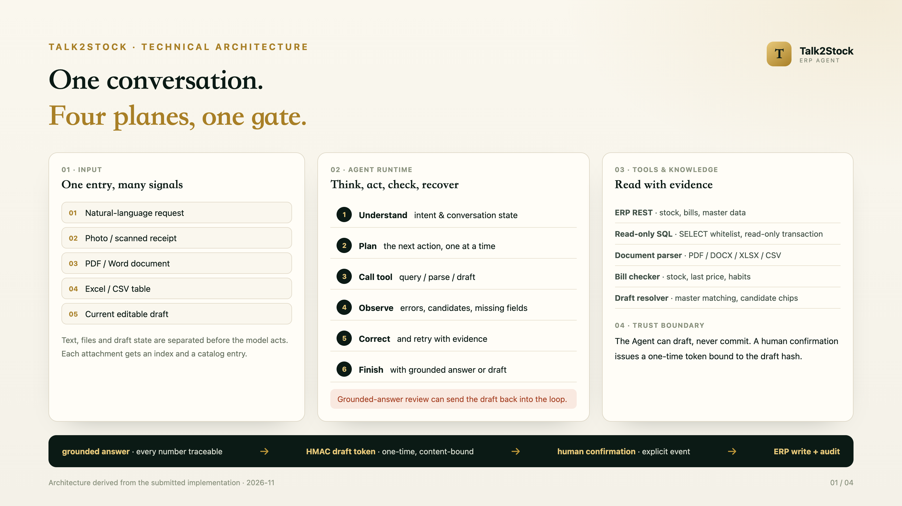
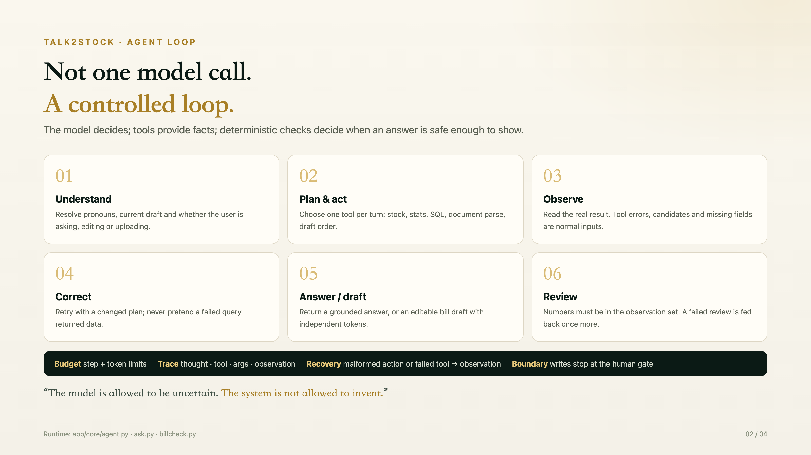
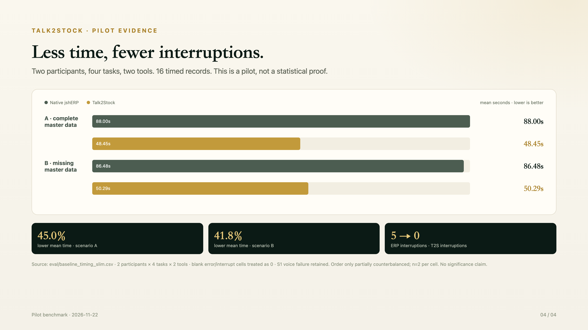
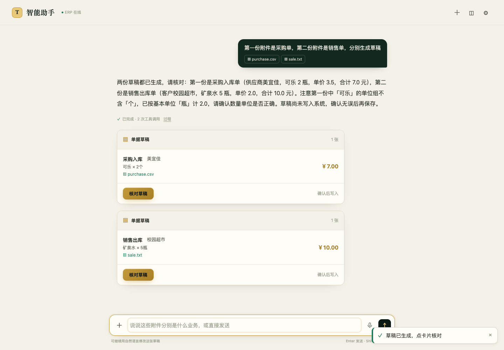
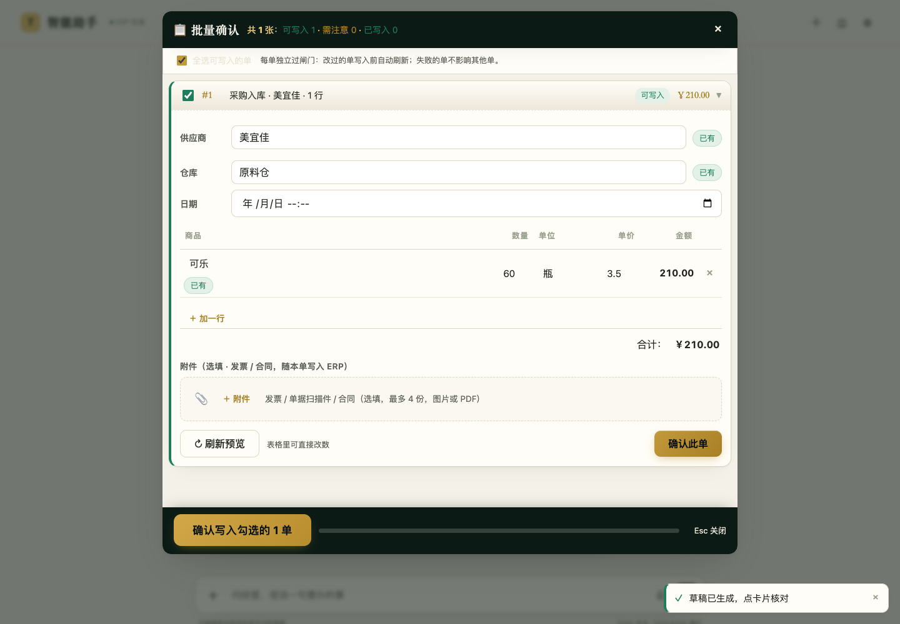

# Talk2Stock：真实 ERP 之上的对话式业务智能体

**最终报告（中文沟通版）**

| 项目 | 内容 |
|---|---|
| 小组 ID | L0X / Group X（待填） |
| 项目标题 | Talk2Stock — Conversational Business Agent on a Real ERP |
| 项目对接用户 / 赞助方 |  credible proxy user（2 名无 ERP 经验组员）＋ 公开仓库外部反馈（GitHub issue #1、#2） |
| 开发平台与主要框架 | AI coding 工具：ZCode / Codex / Claude Code；运行栈：Python 3.12 标准库（零第三方依赖）；原生 HTML/CSS/JS；jshERP（开源 ERP）；OpenAI-compatible 模型接口 |
| 已发布系统链接 | http://111.91.30.23:8090/ （`/` 302 → `/ask`） |
| 提交日期 | 2026-12-20 |

> 本中文版用于组内沟通与内容校准；最终提交为英文版，正文 10–15 页、11 号字、附录不计页，文件命名 `L0X_GroupX_final.pdf`。

---

## 1. Executive Summary

小微商贸企业已经在用 ERP，但 ERP 默认操作者“熟悉字段、主数据齐全”。现实是：录单的人往往不是 ERP 专家，新供应商、新商品、新规格持续出现。我们把成本拆成两笔：**翻译成本**（一句话变成供应商、商品、数量、单位、单价、仓库、日期）和**档案修复成本**（发现档案不存在，退出录单、去建档、再回来重填）。实测一张“从美宜佳买 3 瓶可乐”的采购入库单，在原版 jshERP 里约 **25 次点击 + 2 次流程中断**。

Talk2Stock 是架在真实开源 ERP 之上的对话式前台。ERP 一行未改，所有读写走官方 REST；模型负责理解、规划、选工具与解释，确定性代码负责匹配、校验、算术与令牌，人保留最后那一次写入决定权。系统支持一句话/多单/表单/Excel/图片录入、只读问答、经营看板、采购建议与多步经营诊断。

已测效果：受控试点 16 条计时中，场景 A 从 88.00 秒降到 48.45 秒，场景 B 从 86.48 秒降到 50.29 秒，ERP 侧 5 次流程中断降为 0（n=2，仅描述性）；冻结录单语料整单全对率 98.3%、幻觉字段 0；问一问冻结语料 94.1%–95.0%；统一 Agent 冒烟 5/5；离线回归 206 项全绿；公网链接组外可打开。

---

## 2. Problem and GenAI Task

### 2.1 业务问题与目标用户

目标用户不是 ERP 管理员，而是四类真实角色：

| 角色 | 真实处境 | 系统给什么 |
|---|---|---|
| 录单员 / 运营助理 | 懂业务事实，不懂 ERP 术语；被打断就要重来 | 一句话/多单/表格/图片录入；草稿预览；缺字段追问；候选点选 |
| 仓库 / 运营 | 要即时数字，不想翻报表 | 只读问答（库存、今日/本月统计、单据、欠款、任意只读 SQL） |
| 老板 / 经营者 | 看不清经营，只要结论与异常 | 经营看板九卡；采购建议；AI 洞察；日报；深度诊断 |
| 一人公司 / 小卖部 | 一个人管所有事，没人建档、没人教 | 档案随单自动建；按句录入；单机/单容器部署 |

需求验证来自三条线：国家统计局第五次经济普查的小微商贸数据、用友/简道云/象过河的实操文档、以及公开仓库收到的两条真实外部 issue。**issue #1**（《AI 不是给穷人用的》）指出“一个配件多个规格，AI 不一定对得上”；逐条核对代码后确认四个技术点中三个半是真的，随后重写匹配层、把规格场景做成 8 条冻结语料，并把“同名多档案绝不静默取第一条”写进不变量。**issue #2** 来自另一位开源作者：“有兴趣适配我的 ERP 吗？”——这说明需求不止于课程演示，而是真实系统之间的迁移诉求；我们的回答是“逐系统适配”，而不是假装一个通用 provider。

**证据如何改变设计：**

| 证据 | 设计变更 |
|---|---|
| issue #1：同名商品多规格 | 歧义返回带型号候选；`material_id` 点选直达；规格数字在 prompt 与清洗规则里都保留；8 条规格用例进冻结语料 |
| issue #2：希望适配另一个 ERP | 明确 adapter 边界：当前只绑定 jshERP REST 契约；下一个系统复用 Agent/工具/信任层，但重写 adapter，不做通用 provider |
| 试点：用户为建档退出录单 | 档案随单自动建；草稿标“将新建”；一次确认同时创建档案与单据 |
| 试点：用户不信任没来历的数字 | 确认卡每个字段标注来源（抽取/匹配/默认/建议新建） |
| 试点：仓库里用手机 | 390px 布局、底部标签栏、单行输入，并做浏览器实测 |

### 2.2 为什么是生成式 AI

传统非生成式方案（表单、模板、正则）在三个地方失效：用户表达无限（“美宜佳送来三十瓶可乐，三块五一瓶”）、输入格式未知（Excel 表头来自金蝶/用友/手工表）、附件形态未知（照片、PDF、多文件混排）。这些是语言与结构判断问题，适合 LLM；而数量、单价、库存、欠款、令牌、写入，必须由确定性代码负责。**GenAI 的价值不是替人算账，而是把“人话”与“账本”之间的翻译做对，并且承认自己什么时候不知道。**

产品边界因此写死：Agent 自主到草稿为止；不能提交、不能删除、不能改已有单据；ERP 仍是系统记录，人仍是写入决策者。

### 2.3 成品能力（一句话版本）

一个入口，能查、能起草、能修表、能看经营；所有写入停在人工确认卡前；每一次数字都可回溯到工具观察。

---

## 3. System Design and Implementation

### 3.1 架构与一条真实请求的全链路

系统分四层，按“失败方式不同”切开：

- **入口层**：文本、文件（≤6 个）、图片、当前草稿状态；统一进 `/api/ask` 与 SSE 流。
- **Agent 运行时**：手写 JSON 动作循环（`core/agent.py`，319 行）；模型每轮返回 `{thought, tool, args}` 或最终回答；服务端执行工具、把观察回喂；预算 4/5/8/10 步。
- **事实工具层**：ERP REST（库存/单据/主数据/欠款）、只读 SQL（SELECT 白名单、只读事务、行数与超时限制）、文档/历史单据 BM25 检索、Excel/PDF/DOCX/CSV 解析、草稿校验。
- **信任层**：确认卡、内容哈希、一次性 HMAC 令牌、nonce 黑名单、审计台账、seed 回滚。

{width=88%}

**一条真实请求的完整追踪**（输入 → 每一步的输入/输出 → 最终结果）：

> 用户输入：“从美宜佳买30瓶可乐，单价3块5，入原料仓”

1. **入口层**：收到文本与会话上下文；无附件、无图片；组装 system prompt（工具目录 + 主数据参考 + 会话历史）。
2. **Agent 决策 1**：模型读到工具目录，判断这是“新建采购入库草稿”，选择 `draft_order`，参数 `{text: 原话}`。输入是自然语言；输出是一个工具名与参数（JSON）。
3. **工具执行（起草）**：`llm.parse` 抽取业务类型/往来单位/明细/数量/单位/单价/仓库 → `billcheck` 做只读校验（库存、历史价、操作员习惯、往来记录）→ `draft.prepare_bills` 匹配主数据并生成预览（字段来源标注：抽取/匹配/默认/建议新建）→ `gate.issue` 对草稿内容做哈希并签发一次性令牌。输入是原话 + ERP 主数据；输出是草稿 JSON + 预览 + 令牌。
4. **Agent 决策 2**：模型读到工具观察（草稿已生成、哪些字段缺失、是否需要追问），输出最终回答：“草稿已生成，请核对……确认无误后可在确认卡上提交。”输入是结构化观察；输出是自然语言，但**不允许出现观察之外的新数字**。
5. **接地校验**：回答中的数字逐个与工具观察比对；不一致则退回模型重写一次，仍失败走确定性模板。
6. **人工确认**：确认卡展示往来单位、仓库、明细、数量、单位、单价、合计、风险提示；用户改任何字段都会刷新预览并重签令牌。
7. **写入**：`/api/commit` 校验令牌签名、草稿哈希、nonce 未使用；通过后调用 ERP 官方 REST 建单；写入审计（原话、模型、提示词版本、diff、结果）。输入是已确认草稿；输出是一张 ERP 单据号。
8. **结果**：ERP 里出现一张可审核的采购入库单；Agent 全程没有直接写库。

这条链路同时回答三个问题：**input 是什么**（自然语言 + 主数据 + 附件）、**AI 做了什么**（意图、工具选择、抽参、组织回答、观察后修正）、**output 是什么**（带来源标注的草稿、可核对的回答、一次经人确认的写入）。

### 3.2 模型与参数配置

- **平台**：任意 OpenAI-compatible 接口；模型档案在设置页增删，密钥只从 `.env` 读取，不落 `config.json`。
- **模型**：演示与评测使用 DeepSeek V4.1 Flash、Qwen3.8-Flash-Next、GLM 系列；同一套 prompt 与工具契约可切换。决策步可单独指定低延迟模型（`llm.agent_model`），把“短 JSON 动作”和“长文本生成”分开。
- **关键参数**：`temperature` 低值；决策输出封顶 2000 token（推理模型思考会占满预算导致 JSON 截断）；`reasoning_effort=low`；步数预算按入口区分（问答 8、日报 5、诊断 10、通用 4）；token 预算只作保险丝，主约束是步数。
- **Prompt 设计**：系统提示词包含角色、工具使用规则、单据契约、日期块（把“今天/昨天/前天”换算成绝对日期）、主数据参考、会话上下文、数字接地禁令。完整 prompt 见附录 B。
- **选型理由**：任务以中文口语、结构化 JSON、工具选择为主，不需要最大模型；低延迟与稳定 JSON 比“更聪明”更重要。评测显示同一提示词下不同模型整单全对率 96.7%–98.3%，差异主要来自网络波动与 JSON 稳定性。

### 3.3 数据与知识检索

- **数据源**：jshERP 业务 REST（库存、单据、主数据、欠款）；ERP 全库只读 SQL；用户上传的 Excel/CSV/PDF/DOCX/图片；操作文档与历史单据（BM25）。
- **权限**：ERP 账号联动登录（密码不落盘）；管理员/成员两级；只读 SQL 使用只读事务与 SELECT 白名单；私有模型档案按登录者隔离；租户隔离由 ERP 侧保证。
- **预处理与更新**：主数据实时拉取并做短缓存；Excel 先 `inspect` 出工作表清单与前 8 行，再由 LLM 猜表头映射（≤2 轮有界修复），行→草稿是确定性变换；文档/历史单据建 BM25 双索引，随写入增量更新。
- **为什么不做向量 RAG**：ADR-3 评估后否决——业务问题以精确数字、时间窗、排名为主，向量召回容易“看起来相关但数字不对”；改用“专用工具 + 只读 SQL + BM25”，把召回变成可复核的查询。
- **检索不到怎么办**：工具返回空/错误时作为观察回喂，模型可换工具或修正参数一次；仍失败则明确说“没查到”，不把空结果说成“没有数据”。歧义商品返回带型号的 top3 候选，绝不静默取第一条。

**一次真实检索追踪**：问“上个月哪个商品卖得最多？”→ 模型选 `sql_query`，生成对 `jsh_depot_item × jsh_depot_head` 的只读聚合（销售出库、上一个自然月、按商品分组、按数量降序、limit 5）→ 服务端在只读事务里执行（SELECT 白名单、行数上限）→ 返回 `[{name, qty}]` → 模型回答“上月卖得最多的是 X，N 件” → 接地校验确认名字与数字都在观察里。若表名写错，数据库错误原样回喂，`dbread` 用 difflib 给候选表名，模型有一次改对的机会；该回路由 `tests/test_dbread_hint.py` 覆盖。

### 3.4 工作流与异常处理

```
用户输入
  → 统一 Agent 循环（模型：意图 / 计划 / 工具选择）
      → 确定性工具（REST / 只读 SQL / 检索 / 文件解析 / 起草 / 校验）
      → 观察回喂（成功数据、空结果、参数错误、SQL 报错、超时）
      → 模型修正或收口
  → 接地校验（数字必须来自观察）
      → 通过：回答 / 草稿
      → 不通过：退回重写一次 → 确定性模板兜底
  → 草稿：确认卡 → 一次性令牌 → 人工确认 → ERP 写入 → 审计
```

异常处理逐项写死：未知工具 → 观察里列出合法工具名；参数异常 → 返回字段级错误；工具报错 → 原样回喂，模型可修正一次；SQL 表名错误 → `dbread` 用 difflib 返回候选表名；模型 429/超时 → 作为观察重试，步数耗尽走兜底并明确告知“查询失败，请稍后再试”；预算耗尽 → 给模型一次“只准作答”的收口机会；接地失败 → 退回重写，仍失败用模板。

**工具目录（模型选择，服务端执行）：**

| 工具 | 输入 | 输出 | 用途 |
|---|---|---|---|
| `stock_query` | 商品、可选仓库 | 分仓库存 | 库存查询 |
| `today_stats` / `month_stats` | — | 采销笔数与金额 | 期间统计 |
| `debts` | — | 应收/应付 top 名单 | 谁欠谁 |
| `recent_bills` / `query_bills` | 条数、时间窗、往来单位、商品 | 单据头与明细 | 单据查询 |
| `low_stock` / `stock_value` | 阈值 | 低库存/负库存清单；库存总值 | 预警与货值 |
| `master_count` | 实体 | 数量 | 主数据计数 |
| `doc_search` | 查询词 | BM25 片段 | 操作文档与历史单据 |
| `sql_query` | SELECT | 行集 | 专用工具覆盖不了的只读问题 |
| `procurement_suggest` | 窗口、覆盖天数 | 补货清单与公式输入 | 采购建议 |
| `draft_order` | 原话、可选附件编号 | 草稿、预览、令牌 | 起草单据 |

{width=78%}

**多单与表格导入**：一句话用分号分段、或一次多个附件，可以产出 `bills[]` 多张草稿；每张独立预览、独立一次性令牌，批量预览逐单写入。表格导入刻意拆开：`inspect` 返回工作表清单与前几行；LLM 只判断表头行与列映射（最多两轮有界修复）；`transform` 是确定性变换；`resolve` 生成逐行草稿与令牌；`commit` 只写勾选行（10 行一块）。修复 agent 只读失败行并给修正映射，不写库。附件按编号管理，模型必须按编号或文件名选择；用户没说时工具拒绝猜，先追问。

### 3.5 写入边界（不变量）

| 不变量 | 实现 | 防止的失败 |
|---|---|---|
| 无令牌不写入 | `commit` 拒绝任何无有效令牌的请求 | 绕过 UI 直接调用 |
| 令牌绑定内容 | HMAC 载荷包含草稿哈希 | 确认后篡改或传输中修改 |
| 一次性使用 | 持久 nonce 黑名单拒绝重放 | 同一确认提交两次 |
| 写前预检 | 未消歧的同名明细直接拒绝提交 | 半截单、错档写入 |
| 审计留痕 | 原话/模型/提示词版本/diff/结果 | 无法回溯“为什么写成了这样” |

---

## 4. Evaluation and Improvement

### 4.1 测试设计（先定标准，再跑）

| 测试 | 用例与来源 | 成功标准 | 评判方式 |
|---|---|---|---|
| 录单解析（端到端子任务） | 60 条冻结语料 + 8 条规格对抗（issue #1 场景） | 整单关键字段全对；幻觉字段 0；p95 延迟 | gold 人工标注 + 脚本逐字段比对 |
| 问一问（端到端） | 34 条冻结问句（简单统计/多工具/复合/越界），另有 40 条含 draft 类版本 | 答案正确 + 数字全部来自工具观察 + 数字齐全 | 脚本判定 + 失败逐条归因 |
| 统一 Agent 冒烟 | 5 条核心行为（查询/统计/起草/追问/越界） | 5/5，且答案 grounded | 脚本判定 |
| 人工基线 | 2 名无 ERP 经验组员 × 4 任务 × 2 工具 = 16 条计时 | 完成时间、错误数、中断次数 | 现场计时 + 原始备注 |
| 离线回归 | 206 项单元/集成测试 | 全绿 | CI + 本地 |

端到端测试与模型子任务测试分开：录单评测只看“最终草稿是否对”，问一问只看“最终答案是否正确且接地”，单元测试覆盖闸门、匹配、清洗、附件、认证等模型之外的逻辑。

**为什么这些用例能代表真实场景**：60 条通用录单语料与试点原话同一口语风格（名称、单位、价格混在一句话里）；8 条规格用例直接来自 issue #1；对抗子集故意删信息（业务类型含糊、缺数量），检验系统是追问还是编造。问一问语料混合单工具、多工具、复合、越界四类，因为这正是早期原型暴露的四种失败模式。16 条计时是试点的全量记录（含失败的语音尝试），不是挑过的子集。

### 4.2 对比实验

同一批输入、同一套打分标准，比较三代方案：

| 方案 | 配置 | 用例 | 结果 |
|---|---|---|---|
| 原版 ERP 手工录单 | jshERP 原生界面 | 16 条计时 | 场景 A 88.00s / B 86.48s；5 次中断；一张单约 25 次点击 + 2 次中断 |
| 规则优先原型 | 正则路由 + 单次抽取 | 34 条问句 / 60 条录单 | 问一问 76.5%；录单 78.3%（v1 prompt） |
| 统一 Agent（本地冻结口径） | 手写循环 + 工具 + 接地 | 34/40 条问句；60+8 条录单；5 条冒烟 | 问一问 94.1%–95.0%；录单 98.3%、幻觉 0；冒烟 5/5 |
| 统一 Agent（部署口径，2026-11-24） | 同一代码跑在公网实例，OpenRouter `deepseek/deepseek-v4.1-flash-1017`，线上数据 | 71 条录单；34 条问句 | 录单 63/71 = 88.7% 整单全对，幻觉 1，item_price 93.0%，均值 10.81s / p95 14.05s；问一问 29/34 = 85.3%，0 兜底，均值 6.26s / p95 16.16s |

说明：不同代际语料与 prompting 不同，数字不能硬比；表内每一行都标注了对应语料与版本，原始结果在 `eval/results/`。部署口径使用不同模型档案与不同 ERP 数据集，与本地冻结口径并排报告，不做平均。

{width=78%}

### 4.3 失败案例分析

**F1 · 日期缺失（真实迭代，v1 → v2）**
- 输入：“昨天的单再录一遍”。
- 预期：把“昨天”换算成绝对日期并生成草稿。
- 实际（v1）：prompt 没有注入“今天”，模型不知道今天是几号，无法换算，录单失败。
- 故障定位：系统提示词缺少日期块。
- 修改：在 prompt 注入当前日期与相对日期换算规则；评测语料保留日期类用例。
- 重测：两模型日期类失分全部消除；录单整单全对率 78.3% → 98.3%。

**F2 · 规则截胡复合问题**
- 输入：“今天卖了多少？另外库存的货总共值多少钱？”
- 预期：两个数都给。
- 实际（旧版）：规则层命中 `today_stats`，只答前半句。
- 定位：规则只按意图正则匹配，没有复合意图护栏。
- 修改：规则退出决策位；复合子问题拆成显式清单注入 goal；每个子问题必须取证。
- 重测：compound 类从 67% 提升并保持在评测中；代价是简单问句也要过一次决策（见 4.4 与 5）。

**F3 · 规格丢失（issue #1 驱动的真实缺陷）**
- 输入：“M8螺丝 20 盒”。
- 预期：匹配“螺丝 / M8×20”档案。
- 实际（旧版）：同名两档时静默取第一条，可能写到 M10×30；或清洗规则把“M8”剥掉。
- 定位：匹配层无歧义拦截；prompt 与清洗逻辑对“名字里的数字”规则冲突。
- 修改：同名多档案返回 `ambiguous` + 带型号候选；`material_id` 点选直达；量词改必选（“6号电池”不再被剥成“号电池”）；spec 组 8 条进冻结语料。
- 重测：spec 8/8；全量 206 项单测；端到端写入单明细条码确认命中正确档案。

**F4 · 预算与网关波动（未完全解决）**
- 现象：模型网关固定注入约 8.5K token、推理模型在短 JSON 上烧预算、偶发 429；表现为“查询了 8 步但没有得到可用的数据”。
- 定位：步数/输出预算与网关行为不匹配；429 被当成普通观察重试，烧完步数才兜底。
- 修改：决策输出封顶、`reasoning_effort=low`、按入口区分预算、错误作为观察；429 快速失败并提示。
- 现状：兜底不会让用户看到假数字，但延迟与成功率仍受外部配额影响——这是部署风险，不是模型能力问题。

**F5 · 部署全量：单价字段错误集中（2026-11-24）**
- 输入：71 条录单语料全量走公网实例 `/api/parse`（OpenRouter DeepSeek 档案、线上 ERP 数据）。
- 预期：71 张全对。实际：63/71 = 88.7%；失败分布 item_price ×5、party ×2、biz+qty ×1、date ×1；幻觉字段 1。
- 定位：部署档案与数据集都和本地冻结口径不同；单价失败集中在多行/总价场景，且部署线路更慢（均值 10.81s、p95 14.05s，本地 2.6s）。
- 修改：部署数字单独报告，不与本地 98.3% 混用；失败用例 ID 进入下一轮 prompt 迭代清单。
- 重测与不确定：要归因“模型差异还是主数据差异”，需要在同一模型下本地复跑；当天本地网关配额 429 阻断了这一步——这是未解决项，不是已解决项。

### 4.4 用户反馈

2 名无 ERP 经验组员，每人 4 个任务、两种工具，共 16 条正式记录。客观数据：场景 A 88.00→48.45 秒（-45.0%），场景 B 86.48→50.29 秒（-41.8%），中断 5→0。主观反馈集中在三句：“不用退出录单去建档”“知道每个字段是哪来的”“手机上也能用”。基于反馈做的改动：档案随单自动建、确认卡字段来源标注、移动端 390px 首屏收紧、失败回复可一键重试。

必须说明：n=2、每格 2 条、顺序仅部分抵消，只能支持方向性结论，不能做显著性检验；主观意见与客观计时分开记录，空白错误/中断按 0 计，语音失败样例保留不剔除。

---

## 5. Limitations and Future Work

现存短板（均有触发条件与证据）：

1. **单据侧规模边界**：`/depotHead/list` 带 `search` 时翻页不可靠，单类单据超约 200 张只覆盖最新一页；260 张真实未付单实测欠款漏 23%。
2. **复合问句**：34 条语料中 compound 通过率 67%，是问答侧最后一块短板。
3. **输入格式边界**：扫描 PDF 需要走图片路径（本地文本提取不能 OCR）；旧版二进制 `.doc/.xls` 不支持。
4. **用户研究规模**：pilot n=2，不足以做显著性结论；尚无正式 SUS 量表。
5. **部署与配额**：单租户、单实例；模型网关的配额/限流会直接影响延迟与成功率。
6. **通用适配未做**：当前只适配 jshERP 的 REST 契约，没有统一 provider 抽象。

后续方向（每项对应一个现存局限）：

1. **单据聚合改时间桶/SQL 直查** —— 解决 200 张翻页边界，让欠款与单据统计在 1000+ 规模下可信。
2. **复合问句拆解与多单全链路冻结评测** —— 解决 compound 67% 与“多单/附件只做过冒烟”的证据缺口。
3. **第二个 ERP 的 adapter 试点** —— 回应 issue #2 的真实迁移需求；不做通用 provider，只做“同一职责分层、逐系统适配”，先以只读问答 + 草稿为最小闭环。

**生产就绪评估（哪些是真的，门槛在哪）：**

| 维度 | 当前证据 | 生产门槛 |
|---|---|---|
| 数据正确性 | 草稿校验、数字接地、闸门测试、受控 seed 与回滚 | 每个 release 分支跑冻结语料并按版本对比 |
| 安全 | 一次性 HMAC、nonce 防重放、公开配置无密钥 | HTTPS、强制鉴权、凭据轮换、拒绝写入审计演练 |
| 可靠性 | 确定性兜底、错误作为观察、逐步轨迹 | 供应商超时策略、队列、面向操作人的故障状态 |
| 规模 | 只读 SQL 聚合在 1200 单据通过；当前单用户 | release 构建上做并发与租户隔离测试 |
| 运维 | seed、数据库备份、审计台账 | 告警、恢复演练、值班归属 |

---

## 6. Team Contributions and Reproducibility

### 6.1 分工

| 成员 | 学号 | 具体交付 |
|---|---|---|
| （待填） | （待填） | 问题定义、需求验证、用户测试 |
| （待填） | （待填） | Agent 运行时、工具层、提示词迭代 |
| （待填） | （待填） | 草稿/闸门/审计/权限 |
| （待填） | （待填） | 前端（助手页、确认卡、看板、移动端） |
| （待填） | （待填） | 评测资产、基线实验、失败分析 |
| （待填） | （待填） | 部署、CI、文档与复现 |

### 6.2 开发模式

纯写代码 + AI 辅助编码（AI-assisted coding）。使用过的 AI 开发工具：ZCode、Codex、Claude Code（代码生成、重构、测试补齐、文档整理）。生成内容的校验方式：①每次改动跑 206 项离线回归与 CI（`py_compile` + unittest + 前端内联 JS 语法检查）；②涉及模型行为的改动必须跑冻结评测并把原始结果落 `eval/results/`；③涉及 UI 的改动做 1440px/390px 浏览器验收；④涉及写入的改动走“复制样本 → 修改 → 四件套验证 → 回滚”流程。AI 生成但未经上述验证的内容不进入报告结论。

### 6.3 访问与复现

- 访问地址：http://111.91.30.23:8090/ （组外可直接打开；`/` 302 到 `/ask`）。
- 登录：使用 ERP 账号（演示账号见附录 A；管理员账号用于诊断与配置）。
- 本地复现：仓库根目录执行

```
python3 -I -m unittest discover -s tests     # 206 项离线回归
python3 -I eval/seed_demo.py --yes            # 评测前恢复受控演示数据
python3 -I eval/run_unified.py                # 统一 Agent 冒烟（5 条）
python3 -I eval/run_ask.py                    # 问一问冻结语料（34 条）
python3 -I eval/run.py --tag <tag>            # 录单 v2 语料（68 条）
```

- 前置：本地 ERP 容器（jshERP + MySQL + Redis）已启动，`app/.env` 配置 ERP 凭据与至少一个模型 Key。
- 评测口径：模型、语料版本、测量日期必须一起报告；网关配额异常（429）的一轮不计入结论。

---

## 附录 A · 架构图与访问

- 架构图：`docs/final/assets/architecture.png`（四层：入口 / Agent 运行时 / 事实工具 / 信任层）。
- Agent 循环图：`docs/final/assets/agent-loop.png`（六步受控循环与回答检查）。
- 附件归属图：`docs/final/assets/attachments.png`。
- 访问：http://111.91.30.23:8090/ ；演示账号：（待填）。

{width=46%}

{width=30%}

{width=46%}

{width=46%}

{width=46%}

## 附录 B · 完整 Prompt（节选）

系统提示词（录单抽取）包含：角色与输出 JSON 契约；业务类型枚举；主数据“整串照抄”规则；规格数字属于名字的一部分；日期块（今天 + 相对日期换算）；低置信度标注；禁止编造字段。Agent 决策提示词包含：工具目录；每次只输出一个动作；观察可能是错误；数字只能来自观察；步数与收口规则；越界拒答。表格映射提示词包含：只判断表头行与列映射；不猜业务；输出 JSON；失败返回空映射。完整文本见 `app/core/llm.py` 的 `SYSTEM_PROMPT`、`SHEET_MAP_PROMPT` 与 `app/core/agent.py` 的决策模板。

录单系统提示词原文节选：

```
你是 jshERP 进销存系统的单据录入助理。把用户的业务描述（一句话/一段话/一张单据照片的内容），
转成单据 JSON。输出永远是 {"bills": [...]} 数组——哪怕只有一张单。

# 绝对不要编造这些字段
单据编号、totalPrice、金额合计、条码、materialId、organId、tenantId、账户ID、审核状态。

# 多笔业务拆分（本版本核心规则）
含多笔不同业务时（分号分段、又买又卖、不同往来单位、照片里不止一张单），
必须拆成 bills 数组里的多张单；后一笔的往来单位/商品/单价绝不搬给前一笔。

# 字段规则
items[].name 只写商品名本身，但型号/规格必须完整保留——
"M8螺丝"→"M8螺丝"、"6号电池"→"6号电池"、"2.5平方电线"→"2.5平方电线"。
```

运行时追加的日期块为 `今天是 YYYY-MM-DD`；模型必须先把“今天/昨天/前天”换算成绝对日期，再填 `oper_time`。完整提示词版本化在 `app/core/llm.py`（`PROMPT_VERSION = v6-20261124`，新增“只认明确日期；只说早上/下午时 `oper_time` 留空”规则）。

## 附录 C · 测试日志与统计

- 录单（本地冻结）：`eval/results/run_20261010-235627-workbuddy-promptv2.md`（98.3%，幻觉 0）、`run_20261025-153108-promptv4-spec-final.md`（spec 8/8）。
- 录单（部署全量，2026-11-24）：`eval/results/http_parse_20261124.json` —— 63/71 = 88.7% 整单全对，幻觉 1，item_price 93.0%，均值 10.81s、p95 14.05s。
- 问一问：`eval/results/ask_20261116-060447-v8b-full.md`（95.0%，40 条）、`ask_20261109-054818-v4.md`（94.1%，34 条）；部署全量 `eval/results/http_ask_20261124.json` —— 29/34 = 85.3%，0 兜底，均值 6.26s / p95 16.16s（部署口径：不校验 gold 数字，只看接地 + 关键词 + 非兜底）。
- 冒烟：`eval/results/unified_agent_smoke_20261124-005822.json`（5/5，seed 后）。
- 基线计时：`eval/baseline_timing_slim.csv`（16 条）。
- 规模基准：`eval/results/stress_*.md`（800 商品 / 120 供应商 / 1200 单据；P5 0.71s；P6 67.4s 接地）。
- 失败账本：`docs/失败案例与迭代证据-agent升级.md`（C1–C10）。
- 评测口径变更：`eval/ask_cases.jsonl` v2（2026-11-24，路由类型不计分，0 允许自然语言表达）；`eval/run.py` 适配多单契约（parse 返回数组）。
