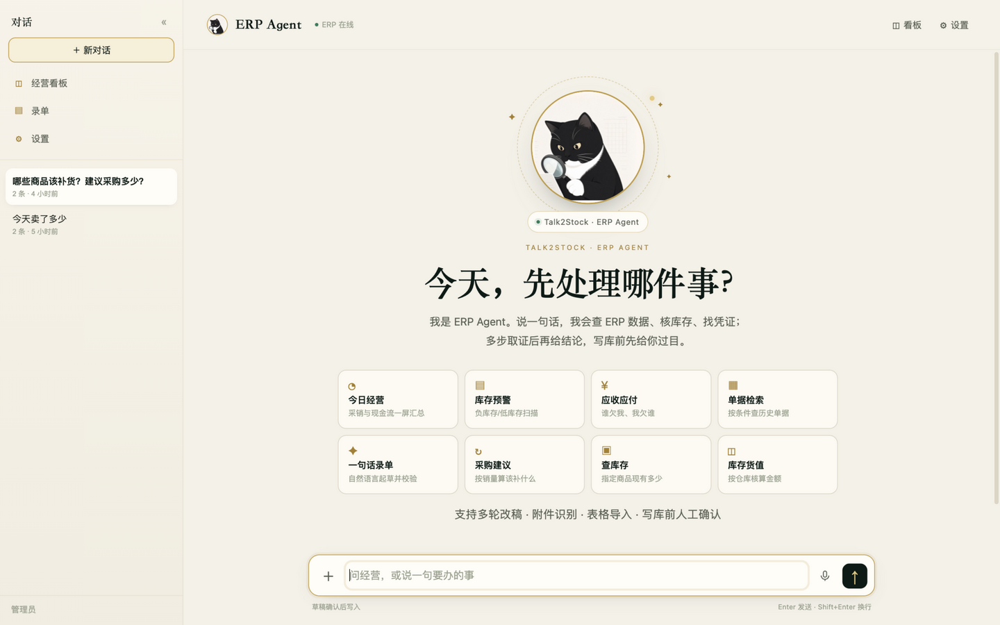
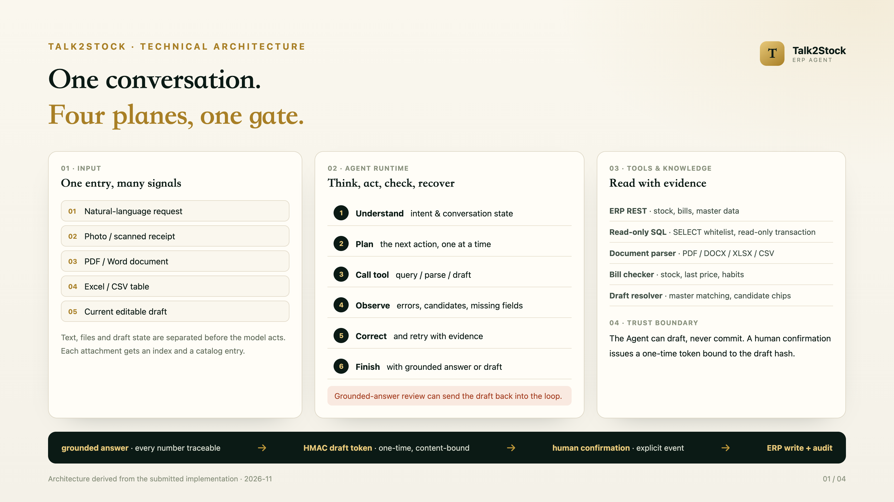
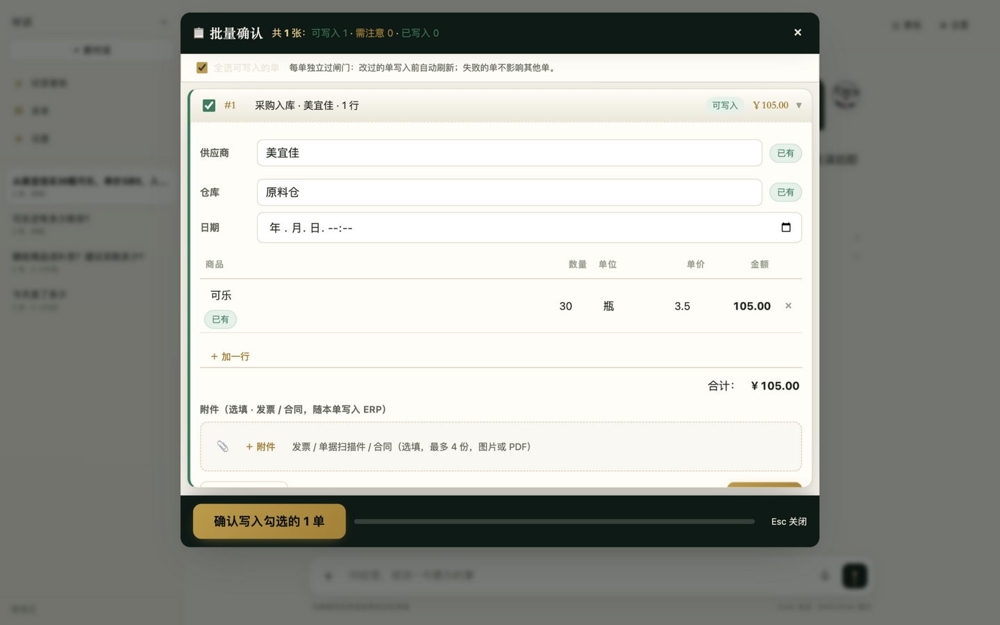
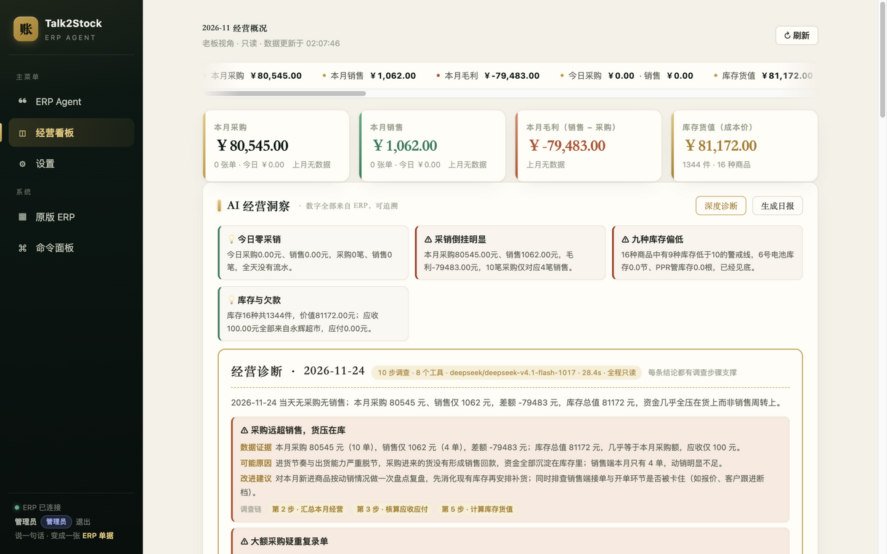
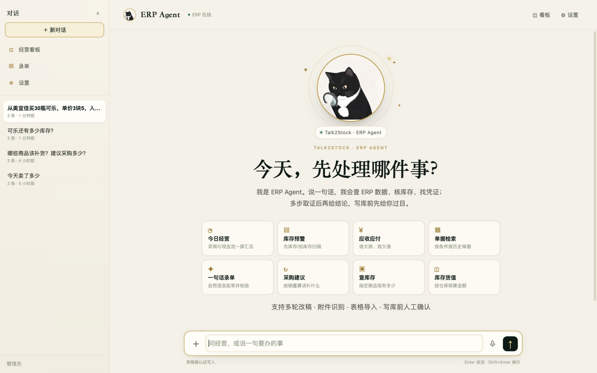

# Talk2Stock：真实 ERP 之上的对话式业务智能体

**最终报告 · IBA6316 / MDS5370 Group Project（2026 秋季）**

| 项目 | 内容 |
|---|---|
| 小组 ID | Group 10（班次 L0X 待填） |
| 项目标题 | Talk2Stock — Conversational Business Agent on a Real ERP |
| 项目对接用户 / 赞助方 | 可信代理用户（2 名无 ERP 经验组员）＋ 公开仓库外部反馈（GitHub issue #1、#2） |
| 开发平台与主要框架 | AI coding：ZCode / Codex / Claude Code；运行栈：Python 3.12+ 标准库（零第三方依赖）；原生 HTML/CSS/JS；jshERP（开源 ERP）；OpenAI-compatible 模型接口 |
| 已发布系统 | http://111.91.30.23:8090/（`/` → 302 → `/ask`） |
| 提交日期 | 2026-12-20 |

**目录**

1. 执行摘要
2. 问题与 GenAI 任务
3. 系统设计与实现
4. 评估与迭代
5. 局限与未来工作
6. 团队分工与可复现
附录 A–C

```{=openxml}
<w:p><w:r><w:br w:type="page"/></w:r></w:p>
```

## 1. 执行摘要

小微商贸企业已经在用 ERP，但 ERP 默认操作者熟悉每个字段、主数据齐全。现实是：录单的人往往不是 ERP 专家，新供应商、新商品、新规格持续出现。我们把成本拆成两笔：**翻译成本**（一句话变成供应商、商品、数量、单位、单价、仓库、日期）和**档案修复成本**（发现档案不存在，退出录单、去建档、再回来重填）。实测一张“从美宜佳买 3 瓶可乐”的采购入库单，在原版 jshERP 里约 **25 次点击 + 2 次流程中断**。

Talk2Stock 是架在真实开源 ERP 之上的对话式前台。ERP 一行未改，所有读写走官方 REST；模型负责理解、规划、选工具与解释，确定性代码负责匹配、校验、算术与令牌，人保留最后那一次写入决定权。系统支持一句话/多单/表单/Excel/图片录入、只读问答、经营看板、采购建议与多步经营诊断。

已测效果：受控试点 16 条计时中，场景 A 从 88.00 秒降到 48.45 秒，场景 B 从 86.48 秒降到 50.29 秒，ERP 侧 5 次流程中断降为 0（n=2，仅描述性）。在定位并修复 Agent 化初期出现的录单准确率回落与延迟升高问题（2026-11-24：部署口径 88.7% / 本地完整链路 91.5%、均值 11.19s）后，稳定版完整链路（2026-11-25，OpenRouter `deepseek/deepseek-v4.1-flash-1017`，prompt `v8-20261125`，引入「事实与建议分离 + 终结型工具 + 确定性快路径」）在 71 条冻结录单语料上达到 **71/71 = 100.0%** 整单全对、**0 幻觉**、均值延迟降至 **4.92 秒（-56%）**；校验 Agent 专项 **4/4 = 100.0%**；34 条冻结问答达 **33/34 = 97.1%**（其中多步 `agent`、`compound` 复合问句、`boundary` 越界全部 **100%**）；统一 Agent 冒烟 **5/5**（起草延迟由 33.71s 降至 **10.24s**，提速 70%）；离线回归 **236/236 全绿**；公网链接组外可打开。第 4 章并排报告历史与最新各轮实测，不做跨轮平均。

---

## 2. 问题与 GenAI 任务

### 2.1 业务问题

ERP 是一台“表单机器”。它默认操作者受过训练、供应商与商品档案齐全、字段口径稳定。小微商贸企业往往三样都不成立。同一句话因此触发两类软件不承认的工作：

- **翻译成本**：“美宜佳送来三十瓶可乐，三块五一瓶”要变成供应商、商品、数量、单位、单价、仓库、日期。每个字段都是一个判断，每个判断都可能出错。
- **档案修复成本**：如果供应商或商品不存在，录单员必须离开单据、打开另一个模块、建好档案、再回来重填。我们实测的一张采购单：25 次点击，2 次中断。

这两笔成本是结构性的，不是界面好不好看的问题。它解释了为什么小企业明明有 ERP 还在用微信和纸，也解释了为什么“把 ERP 做漂亮一点”解决不了问题。

### 2.2 目标用户

| 角色 | 真实处境 | 系统给什么 |
|---|---|---|
| 录单员 / 运营助理 | 懂业务事实，不懂 ERP 术语；被打断就要重来 | 一句话/多单/表格/图片录入；草稿预览；缺字段追问；候选点选 |
| 仓库 / 运营 | 要即时数字，不想翻报表 | 只读问答：库存、今日/本月统计、单据、欠款、任意只读 SQL |
| 老板 / 经营者 | 看不清经营，只要结论与异常 | 经营看板九卡；采购建议；AI 洞察；日报；深度诊断 |
| 一人公司 / 小卖部 | 一个人管所有事，没人建档、没人教 | 档案随单自动建；按句录入；单机/单容器部署 |

### 2.3 为什么做这个，为什么是现在

三个条件让这个项目在 2026 年值得做：

1. **需求真实可见。** 公开仓库收到 issue #1（《AI 不是给穷人用的》），用非常具体的点攻击产品——一个配件多个规格；issue #2 直接问“有兴趣适配我的 ERP 吗？”。前者是用户告诉我们哪里会坏，后者是另一个系统的操作者主动要求同样的能力。这比课程演示更有说服力。
2. **成本曲线终于合适。** 这件事需要大量短而结构化的判断（意图、抽取、映射、解释），不需要长推理；小而快的模型足够且便宜，抽取链路单条约 1.4K token。
3. **缺的不是智能，是编排。** ERP 的 API 已经齐全；缺的是一层能选对 API、读懂结果、发现缺字段、自己修正、并在写入前停住的东西。这是工程问题，也是我们选的问题。

### 2.4 为什么是生成式 AI，而不是传统自动化

传统自动化在三处失效：用户表达无限（“美宜佳送来三十瓶可乐，三块五一瓶”）、输入格式未知（Excel 表头来自金蝶/用友/手工表）、附件形态未知（照片、PDF、多文件混排）。这些是语言与结构判断问题，适合 LLM；而数量、单价、库存、欠款、令牌、写入，必须由确定性代码负责。**GenAI 的价值不是替人算账，而是把“人话”与“账本”之间的翻译做对，并且承认自己什么时候不知道。**

产品边界因此写死：Agent 自主到草稿为止；不能提交、不能删除、不能改已有单据；ERP 仍是系统记录，人仍是写入决策者。

### 2.5 需求如何被验证，以及因此改了什么

| 证据 | 设计变更 |
|---|---|
| issue #1：同名商品多规格 | 歧义返回带型号候选；`material_id` 点选直达；规格数字在 prompt 与清洗规则里都保留；8 条规格用例进冻结语料 |
| issue #2：希望适配另一个 ERP | 明确 adapter 边界：当前只绑定 jshERP REST 契约；下一个系统复用 Agent/工具/信任层，但重写 adapter，不做通用 provider |
| 试点：用户为建档退出录单 | 档案随单自动建；草稿标“将新建”；一次确认同时创建档案与单据 |
| 试点：用户不信任没来历的数字 | 确认卡每个字段标注来源（抽取/匹配/默认/建议新建） |
| 试点：仓库里用手机 | 390px 布局、底部标签栏、单行输入，并做浏览器实测 |

### 2.6 成品能力

一个入口，能查、能起草、能修表、能看经营；所有写入停在人工确认卡前；每一次数字都可回溯到工具观察。

{width=78%}

---

## 3. 系统设计与实现

### 3.1 架构

系统分四层，按“失败方式不同”切开：

- **入口层**：文本、文件（≤6 个）、图片、当前草稿状态；统一进 `/api/ask` 与 SSE 流。
- **Agent 运行时**：手写 JSON 动作循环（`core/agent.py`，325 行）；模型每轮返回 `{thought, tool, args}` 或最终回答；服务端执行工具、把观察回喂；支持终结型工具（`submit_verdict` / `submit_diagnosis` 落定结构化结论后立即退出，避免多余收尾 LLM 往返）；步数预算按入口为 4/7/8/10 步。
- **事实工具层**：ERP REST（库存/单据/主数据/欠款）、只读 SQL（SELECT 白名单、只读事务、行数与超时限制）、文档/历史单据 BM25 检索、Excel/PDF/DOCX/CSV 解析、草稿校验。
- **信任层**：确认卡、内容哈希、一次性 HMAC 令牌、nonce 黑名单、审计台账、受控 seed 与回滚。

{width=78%}

### 3.2 一条真实请求的完整追踪

> 用户输入：“从美宜佳买30瓶可乐，单价3块5，入原料仓”

1. **入口层**：收到文本与会话上下文；无附件、无图片；组装 system prompt（工具目录 + 主数据参考 + 会话历史）。
2. **Agent 决策 1**：模型读到工具目录，判断这是“新建采购入库草稿”，选择 `draft_order`，参数 `{text: 原话}`。输入是自然语言；输出是一个工具名与参数（JSON）。
3. **工具执行（起草）**：`llm.parse` 抽取业务类型/往来单位/明细/数量/单位/单价/仓库 → `billcheck` 做只读校验（库存、历史价、操作员习惯、往来记录）→ `draft.prepare_bills` 匹配主数据并生成预览（字段来源标注：抽取/匹配/默认/建议新建）→ `gate.issue` 对草稿内容做哈希并签发一次性令牌。输入是原话 + ERP 主数据；输出是草稿 JSON + 预览 + 令牌。
4. **Agent 决策 2**：模型读到工具观察（草稿已生成、哪些字段缺失、是否需要追问），输出最终回答：“草稿已生成，请核对……确认无误后可在确认卡上提交。”输入是结构化观察；输出是自然语言，但**不允许出现观察之外的新数字**。
5. **接地校验**：回答中的数字逐个与工具观察比对；不一致则退回模型重写一次，仍失败走确定性模板。
6. **人工确认**：确认卡展示往来单位、仓库、明细、数量、单位、单价、合计、附件与风险提示；用户改任何字段都会刷新预览并重签令牌。
7. **写入**：`/api/commit` 校验令牌签名、草稿哈希、nonce 未使用；通过后调用 ERP 官方 REST 建单；写入审计（原话、模型、提示词版本、diff、结果）。输入是已确认草稿；输出是一张 ERP 单据号。
8. **结果**：ERP 里出现一张可审核的采购入库单；Agent 全程没有直接写库。

{width=78%}

### 3.3 模型与参数配置

- **平台**：任意 OpenAI-compatible 接口；模型档案在设置页增删，密钥只从 `.env` 读取，不落 `config.json`。
- **模型**：DeepSeek V4.1 Flash、Qwen3.8-Flash-Next、GLM 系列；同一套 prompt 与工具契约可切换。决策步可单独指定低延迟模型（`llm.agent_model`），把“短 JSON 动作”和“长文本生成”分开。
- **关键参数**：`temperature=0.0`；决策输出封顶 2000 token（日报 2600 token，避免推理模型思考占满预算导致 JSON 截断）；`reasoning_effort=low`；步数预算按入口区分（问答 8、日报 7、诊断 10、录单校验 4、通用 4）；终结型提交工具成功后立即退出；要素齐全且高置信的单据在校验阶段走确定性库存/习惯预检快路径（0 额外 LLM 调用），缺字段/缺单价/低置信单据走完整多步校验 Agent；token 预算只作保险丝，主约束是步数。
- **选型理由**：任务以中文口语、结构化 JSON、工具选择为主，不需要最大模型；低延迟与稳定 JSON 比“更聪明”更重要。评测显示同一提示词下不同模型整单全对率 96.7%–98.3%，差异主要来自网络波动与 JSON 稳定性。
- **Prompt 设计**：角色与 JSON 契约；业务类型枚举；主数据“整串照抄”；规格数字属于名字；日期块（今天 + 相对日期换算）；主数据参考；会话上下文；禁止编造数字。完整 prompt 见附录 B。


**档案与密钥安全。** 模型档案在设置页维护；API Key 只存 `app/.env`（已被 git 忽略），绝不写入 `config.json` 或任何公开接口。公开配置接口只返回脱敏值；泄漏的 Key 可以直接轮换，无需改代码。
### 3.4 数据与知识检索

- **数据源**：jshERP 业务 REST（库存、单据、主数据、欠款）；ERP 全库只读 SQL；用户上传的 Excel/CSV/PDF/DOCX/图片；操作文档与历史单据（BM25）。
- **权限**：ERP 账号联动登录（密码不落盘）；管理员/成员两级；只读 SQL 使用只读事务与 SELECT 白名单；私有模型档案按登录者隔离；租户隔离由 ERP 侧保证。
- **预处理与更新**：主数据实时拉取并做短缓存；Excel 先 `inspect` 出工作表清单与前 8 行，再由 LLM 猜表头映射（≤2 轮有界修复），行→草稿是确定性变换；文档/历史单据建 BM25 双索引，随写入增量更新。
- **为什么不做向量 RAG**：ADR-3 评估后否决——业务问题以精确数字、时间窗、排名为主，向量召回容易“看起来相关但数字不对”；改用“专用工具 + 只读 SQL + BM25”，把召回变成可复核的查询。
- **检索不到怎么办**：工具返回空/错误时作为观察回喂，模型可换工具或修正参数一次；仍失败则明确说“没查到”，不把空结果说成“没有数据”。歧义商品返回带型号的 top3 候选，绝不静默取第一条。
- **一次真实检索追踪**：问“上个月哪个商品卖得最多？”→ 模型选 `sql_query`，生成对 `jsh_depot_item × jsh_depot_head` 的只读聚合（销售出库、上一个自然月、按商品分组、按数量降序、limit 5）→ 服务端在只读事务里执行（SELECT 白名单、行数上限）→ 返回 `[{name, qty}]` → 模型回答“上月卖得最多的是 X，N 件” → 接地校验确认名字与数字都在观察里。若表名写错，数据库错误原样回喂，`dbread` 用 difflib 给候选表名，模型有一次改对的机会；该回路由 `tests/test_dbread_hint.py` 覆盖。

### 3.5 工作流与异常处理

```
用户输入
  → 统一 Agent 循环（模型：意图 / 计划 / 工具选择）
      → 确定性工具（REST / 只读 SQL / 检索 / 文件解析 / 起草 / 校验）
      → 观察回喂（成功数据、空结果、参数错误、SQL 报错、超时）
      → 模型修正或收口
  → 接地校验（数字必须来自观察）
      → 通过：回答 / 草稿
      → 不通过：退回重写一次 → 确定性模板兜底
  → 草稿：确认卡 → 一次性令牌 → 人工确认 → ERP 写入 → 审计
```

异常处理逐项写死：未知工具 → 观察里列出合法工具名；参数异常 → 返回字段级错误；工具报错 → 原样回喂，模型可修正一次；SQL 表名错误 → `dbread` 用 difflib 返回候选表名；模型 429/超时 → 作为观察重试，步数耗尽走兜底并明确告知“查询失败，请稍后再试”；预算耗尽 → 给模型一次“只准作答”的收口机会；接地失败 → 退回重写，仍失败用模板。

**工具目录（模型选择，服务端执行）：**

| 工具 | 输入 | 输出 | 用途 |
|---|---|---|---|
| `stock_query` | 商品、可选仓库 | 分仓库存 | 库存查询 |
| `today_stats` / `month_stats` | — | 采销笔数与金额 | 期间统计 |
| `debts` | — | 应收/应付 top 名单 | 谁欠谁 |
| `recent_bills` / `query_bills` | 条数、时间窗、往来单位、商品 | 单据头与明细 | 单据查询 |
| `low_stock` / `stock_value` | 阈值 | 低库存/负库存清单；库存总值 | 预警与货值 |
| `master_count` | 实体（供应商/客户/商品等） | 数量与示例名称 | 主数据计数 |
| `search_docs` / `search_history` | 查询词 | BM25 片段 / 历史单据命中 | 操作文档与历史单据检索 |
| `sql_query` / `db_schema` | SELECT / 表名 | 行集 / 表字段与样本值 | 专用工具覆盖不了的只读问题 |
| `procurement_suggest` | 窗口、覆盖天数 | 补货清单与公式输入 | 采购建议 |
| `draft_order` | 原话、可选附件编号 | 草稿、预览、令牌 | 起草单据 |

### 3.6 多单、附件与表格导入

一句话用分号分段、或一次多个附件，可以产出 `bills[]` 多张草稿；每张独立预览、独立一次性令牌，批量预览逐单写入。附件按编号管理，模型必须按编号或文件名选择；用户没说时工具拒绝猜，先追问。

表格导入刻意拆开：`inspect` 返回工作表清单与前几行；LLM 只判断表头行与列映射（最多两轮有界修复）；`transform` 是确定性变换；`resolve` 生成逐行草稿与令牌；`commit` 只写勾选行（10 行一块）。修复 agent 只读失败行并给修正映射，不写库。

### 3.7 写入边界（不变量）

| 不变量 | 实现 | 防止的失败 |
|---|---|---|
| 无令牌不写入 | `commit` 拒绝任何无有效令牌的请求 | 绕过 UI 直接调用 |
| 令牌绑定内容 | HMAC 载荷包含草稿哈希 | 确认后篡改或传输中修改 |
| 一次性使用 | 持久 nonce 黑名单拒绝重放 | 同一确认提交两次 |
| 写前预检 | 未消歧的同名明细直接拒绝提交 | 半截单、错档写入 |
| 审计留痕 | 原话/模型/提示词版本/diff/结果 | 无法回溯“为什么写成了这样” |

### 3.8 经营看板与主动智能

看板是老板视角。整页只读，每个数字都来自 ERP 官方统计接口或只读 SQL 层：

| 卡片 | 内容 | 智能成分 |
|---|---|---|
| KPI 行 | 本月采购/销售/毛利/库存货值 | 确定性聚合 |
| AI 经营洞察 | 带数字的四条结论（如“采销倒挂：采购 80,545 对销售 1,062”） | 规则产出事实，LLM 只负责组织语言 |
| 深度诊断 | 10 步调查链，每条结论标注证据步骤 | 同一条 Agent 循环 + 专用工具箱 |
| 智能采购建议 | 补货清单，公式输入全部展示 | 零 LLM：五条聚合 SQL 上的确定性公式 |
| 趋势 / 资金 / 待办 | 近 6 个月曲线、账户余额、待审单据 | 确定性 |
| 商品进销榜 / 库存预警 / 往来排行 / 往来欠款 | 带阈值的排名清单 | 确定性 |
| 最近单据 | 最近 20 张，可排序，草稿单独标出 | 只读 |

采购公式刻意简单、可审计：日均销量 `d` = 窗口净销量 ÷ 天数；采购周期 `L` = 历史采购间隔中位数（不足时用默认 7 天并标注 assumed）；安全库存 `S` = 档案配置的最低库存（`low_safe_stock`）；目标库存 `T = d × (L + 覆盖天数) + S`；可用供应扣减在途未审核采购单数量（`pending_qty`，commit `77a9c36`），建议量 `= ⌈max(0, T − (当前库存 + 在途采购量))⌉`。零销量的商品绝不催货（负库存改提示“账实不符，先盘点”）。结果与其他写入一样，经同一条闸门生成采购入库草稿。

诊断复用 Agent 循环 + 专用工具箱，并有一条硬规则：**每条结论必须引用产生它的证据步骤（evidence_steps）**，其中的每个数字（含顶层总览 `overview`）必须逐字来自那些步骤的观察。图 4 的这次运行：10 步、8 个工具、28.4s、全程只读（2026-11-25 实测：8 步、28.8s、无降级）。日报遵循同样纪律（最多 7 步、终结型 `submit_verdict`）：工具取证、LLM 组织成文、逐条数字接地。

{width=78%}

### 3.9 会话历史与执行面板

每个登录者的会话按用户持久化；侧栏列出最近会话，刷新后可恢复（附录 A 图 A2）。每条回答都暴露执行面板——工具步骤、耗时、token、`✓ 数字已核对` 接地徽章与模型档案——让用户看见“数字是怎么来的”；失败回答提供一键重试，而不是停在报错上。校验 Agent 查到的历史参考价与常用仓库建议（`patches_suggested`）以“一键采纳”按钮展示在确认卡上，绝不静默篡改抽取出的原草稿。

---

## 4. 评估与迭代

### 4.1 测试设计（先定标准，再跑）

| 测试 | 用例与来源 | 成功标准 | 评判方式 |
|---|---|---|---|
| 录单解析（完整链路端到端） | 71 条冻结语料（51 条常规 + 12 条对抗 + 8 条 issue #1 规格用例） | 整单关键字段全对；幻觉字段 0；均值/p95 延迟 | gold 人工标注 + 脚本逐字段比对 |
| 录单校验 Agent | 4 条冻结用例（`eval/billcheck_cases.jsonl`，3 条有历史价 + 1 条无历史价负例） | 历史价接地建议命中；无历史价严守宁缺勿错 | 脚本判定 + 观察接地校验 |
| 问一问（端到端） | 34 条冻结问句（9 rule / 16 agent / 3 compound / 6 boundary），另有历史 40 条版本 | 答案正确 + 数字全部来自工具观察 + 数字齐全 | 脚本判定 + 失败逐条归因 |
| 统一 Agent 冒烟 | 5 条核心行为（查询/统计/起草/追问/越界） | 5/5，且答案 grounded | 脚本判定 |
| 人工基线 | 2 名无 ERP 经验组员 × 4 任务 × 2 工具 = 16 条计时 | 完成时间、错误数、中断次数 | 现场计时 + 原始备注 |
| 离线回归 | 25 个模块共 236 项单元/集成测试 | 全绿 | CI + 本地 |

端到端测试与模型子任务测试分开：录单评测只看“最终草稿是否对”，问一问只看“最终答案是否正确且接地”，单元测试覆盖闸门、匹配、清洗、附件、认证等模型之外的逻辑。

**为什么这些用例能代表真实场景**：60 条通用录单语料与试点原话同一口语风格（名称、单位、价格混在一句话里）；8 条规格用例直接来自 issue #1；对抗子集故意删信息（业务类型含糊、缺数量），检验系统是追问还是编造。问一问语料混合单工具、多工具、复合、越界四类，因为这正是早期原型暴露的四种失败模式。16 条计时是试点的全量记录（含失败的语音尝试），不是挑过的子集。

### 4.2 对比实验

| 方案 | 配置 | 用例 | 结果 |
|---|---|---|---|
| 原版 ERP 手工录单 | jshERP 原生界面 | 16 条计时 | 场景 A 88.00s / B 86.48s；5 次中断；一张单约 25 次点击 + 2 次中断 |
| 规则优先原型 | 正则路由 + 单次抽取 | 34 条问句 / 60 条录单 | 问一问 76.5%；录单 78.3%（v1 prompt） |
| 统一 Agent（本地冻结口径） | 手写循环 + 工具 + 接地 | 34/40 条问句；60+8 条录单；5 条冒烟 | 问一问 94.1%–95.0%；录单 98.3%、幻觉 0；冒烟 5/5 |
| 统一 Agent（本地完整链路，2026-11-24 稳定化前） | OpenRouter DeepSeek，prompt `v7`，校验 Agent 静默覆写草稿字段 | 71 条录单 | 65/71 = 91.5% 整单全对，幻觉 0，均值 11.19s / p95 19.07s；暴露出准确率与延迟退化 |
| 统一 Agent（部署口径，2026-11-24 稳定化前） | 公网实例，OpenRouter `deepseek/deepseek-v4.1-flash-1017`，线上数据 | 71 条录单；34 条问句 | 录单 63/71 = 88.7%，幻觉 1，item_price 93.0%，均值 10.81s / p95 14.05s；问一问 29/34 = 85.3%，0 兜底，均值 6.26s / p95 16.16s |
| **统一 Agent（本地完整链路，2026-11-25 稳定化后）** | **OpenRouter `deepseek/deepseek-v4.1-flash-1017`，prompt `v8-20261125`，事实与建议分离 + 终结型工具 + 确定性快路径 + 复合问句拆解接入** | **71 条录单；4 条校验；34 条问句；5 条冒烟** | **录单 71/71 = 100.0%，幻觉 0，均值 4.92s（-56%）/ p95 16.19s；校验 4/4 = 100.0%；问一问 33/34 = 97.1%（agent 100%、compound 3/3 = 100%、boundary 100%），均值 5.39s / p95 9.22s；冒烟 5/5（起草 33.71 → 10.24s）** |

说明：不同代际语料与 prompting 不同，数字不能硬比；部署口径使用不同模型档案与不同 ERP 数据集，与本地冻结口径并排报告，不做平均。

### C.4 历史评测轮次原始产物（全部保留在 `eval/results/`）

| 轮次 | 文件 | 结果 |
|---|---|---|
| 录单 v1（2026-10-10） | `run_20261010-232858-smoke` / `run_20261010-233247-v1-full` | 78.3%，9 次网关 502 |
| 录单 v2（2026-10-10） | `run_20261010-235627-workbuddy-promptv2` | 98.3%，幻觉 0 |
| 录单 v2（ModelScope） | `run_20261010-235336-moda-promptv2` | 96.7% |
| 录单 v3 复跑（2026-10-12） | `run_20261012-135109-workbuddy-promptv3-rerun` | 96.7%（±1 网络波动） |
| Agent 冒烟（2026-10-25） | `run_20261025-001549-agentloop-smoke` | 15/15，1,359 token/单 |
| 规格组（2026-10-25） | `run_20261025-153108-promptv4-spec-final` | issue #1 修复后 8/8 |
| 清洗审计（2026-10-25） | `run_20261025-163112-audit-clean-name` | spec 8/8 保持 |
| 问一问 v1（2026-11-09） | `ask_20261109-020115` 等 | 76.5% |
| 问一问 v5（2026-11-09） | `ask_20261109-054818-v4` | 94.1% |
| 问一问 v8b（2026-11-16） | `ask_20261116-060447-v8b-full` | 95.0%（40 条） |
| 统一冒烟（2026-11-24） | `unified_agent_smoke_20261124-005822.json` | 播种后 5/5 |
| 部署录单（2026-11-24） | `http_parse_20261124.json` | 严格口径 63/71 = 88.7%（稳定化前） |
| 部署问一问（2026-11-24） | `http_ask_20261124.json` | 29/34 = 85.3%（稳定化前） |
| 校验 Agent 稳定版（2026-11-25） | `billcheck_20261125-142924-v2-20261125-fix.md` | **4/4 = 100.0%**，均值 12.5s |
| 完整链路录单稳定版（2026-11-25） | `run_20261125-143514-v8-stabilized-20261125.md` | **71/71 = 100.0%**，幻觉 0，均值 4.92s / p95 16.19s |
| 问一问稳定版（2026-11-25） | `ask_20261125-143817-v2-20261125.md` | **33/34 = 97.1%**（agent 100%、compound 100%、boundary 100%），均值 5.39s / p95 9.22s |
| 统一冒烟稳定版（2026-11-25） | `unified_agent_smoke_20261125-142617.json` | **5/5**（起草 10.24s，澄清 11.81s，全接地） |
| 规模基准 | `stress_*.md` | 1,200 单据；P4 欠款 SQL 15,600 = 15,600（漏报 0）；P5 0.71s |
### 4.3 失败案例分析

| 用例 | 现象 | 定位 | 处理 |
|---|---|---|---|
| a01、a07、n50、n51（2026-11-24） | 引入校验 Agent 后 `item_price` 失配，整单全对率从 96.7%+ 跌至 88.7%–91.5% | `billcheck.apply_patches` 把历史价/习惯仓静默写回原草稿，覆盖了用户原话未提的空值（且缺少观察接地与单位一致性校验） | **已根治（ADR-16，2026-11-25）：** 实行「事实与建议分离」——草稿忠实保留原话、绝不静默覆写，接地且单位一致的建议入 `check.patches_suggested` 并在确认卡提供一键采纳。全链路升至 **71/71 = 100.0%**，同时校验专项保持 **4/4 = 100%** |
| n27、s07、a05、a01、a12（2026-11-24） | 编号商品名「商品17」被拆出单价 17；模糊量词「一批」「拿点」被猜成 qty=1；省略往来单位时从 few-shot 示例串台复制「美宜佳」或单价 3.5 | prompt `v7-20261124` 的真实抽取漏洞 | **已根治（`v8-20261125`）：** 禁止编号商品名拆价、规定模糊量词必须 `qty=0`+`low`、明确「客户X那里拿点…」归为 `sale_out`+`low`、严禁照抄示例。2026-11-25 复测全部通过 |
| s08 | 只说了“早上/下午”，却填了今天日期 | 录单是当场行为，“早上进了货”即今天 | prompt `v7-20261124`：早上/下午/晚上按当天时段填今天；gold 修正为 `REL:TODAY` |
| a03 | “九龙纸业”变成“玖龙纸业” | 模型归一成主数据写法；gold 缺别名 | 语料加 `party_aliases` |
| 问一问 c1–c3（2026-11-25 前） | 复合问句通过率仅 67% | `ask._compound_hints()` 已写但未接入主循环，且正则会误拆“还有多少” | **已根治（2026-11-25）：** 修正正则前瞻 `还有(?!(?:多少|几|吗|没有|剩))` 并接入 `ask()`；复合问句升至 **3/3 = 100%** |
| 问一问 r5（2026-11-25） | 准确列出了 8 个低库存商品且数字接地，未提总商品数分母 12 | 自然回答“什么货快没了”时省略了全库商品总数 12 | 如实记为 33/34（**97.1%**）中唯一未过项，不改冻结 gold |
| 问一问 d2 | 答“二号仓库”，gold 只写“仓库2” | 关键词写法，不是答错 | 评分关键词已加“二号仓库” |

三个改变过架构的经典迭代值得记录。**F1（日期缺失，v1 → v2）**：第一版 prompt 未注入“今天”，导致相对日期换算失败；注入绝对日期块后整单全对率从 78.3% 升至 98.3%。**F2（规则截胡）**：复合问题被正则规则命中前半句只答一半；规则退出决策位并接入复合子问题拆解后，复合问句达到 3/3 = 100%。**F3（Agent 化初期的准确率与延迟倒退，ADR-16）**：把多步校验 Agent 串到抽取后，初期反而让录单准确率从 96.7%+ 跌到 88.7%–91.5%、均时从 3.6s 飙到 11.19s（`/ask` 起草 33.71s），根因是静默补丁覆写破坏原话保真、且要素齐全的单据也无条件跑 3 轮 LLM。改为「事实与建议分离（草稿保真 + 接地建议一键采纳）+ 终结型工具立即退出 + 完整单确定性快路径」后，整单全对率升至 **71/71 = 100.0%**（0 幻觉），均时降 56%（11.19 → 4.92s），`/ask` 起草降 70%（33.71 → 10.24s）。

### 4.4 用户反馈

2 名无 ERP 经验组员，每人 4 个任务、两种工具，共 16 条正式记录。客观数据：场景 A 88.00→48.45 秒（-45.0%），场景 B 86.48→50.29 秒（-41.8%），中断 5→0。主观反馈集中在三句：“不用退出录单去建档”“知道每个字段是哪来的”“手机上也能用”。基于反馈做的改动：档案随单自动建、确认卡字段来源标注、390px 移动端首屏、失败回复可一键重试。

必须说明：n=2、每格 2 条、顺序仅部分抵消，只能支持方向性结论，不能做显著性检验；主观意见与客观计时分开记录，空白错误/中断按 0 计，语音失败样例保留不剔除。

### 4.5 试点全部 16 条计时记录（`eval/baseline_timing_slim.csv`）

| 受试者 | 场景 | 工具 | 任务 | 秒 | 错误 | 中断 | 备注 |
|---|---|---|---|---|---|---|---|
| S1 | A | erp | n01 | 102.30 | 2 | 1 | 找「采购入库」点错两次；商品录入返工一次；中断一次 |
| S1 | A | t2s | n01 | 61.42 | 0 | 0 |  |
| S1 | A | erp | n03 | 74.46 | 1 | 0 | 找「采购入库」点错 1 次 |
| S1 | A | t2s | n03 | 49.06 | 0 | 0 |  |
| S1 | B | erp | n22 | 124.90 | 1 | 2 | 新建商品点错一次；中断 2 次 |
| S1 | B | t2s | n22 | 71.58 | 1 | 0 | 语音输入不可用（耗时保留） |
| S1 | B | erp | n23 | 82.32 | 0 | 0 |  |
| S1 | B | t2s | n23 | 41.68 | 0 | 0 |  |
| S2 | A | erp | n01 | 106.70 | 2 | 0 | 找「采购入库」；找商品 |
| S2 | A | t2s | n01 | 45.35 | 0 | 0 |  |
| S2 | A | erp | n03 | 68.53 | 0 | 0 |  |
| S2 | A | t2s | n03 | 37.98 | 0 | 0 |  |
| S2 | B | erp | n22 | 65.86 | 0 | 1 | 新建供应商中断一次 |
| S2 | B | t2s | n22 | 40.29 | 0 | 0 |  |
| S2 | B | erp | n23 | 72.85 | 0 | 1 | 新建供应商中断一次 |
| S2 | B | t2s | n23 | 47.61 | 0 | 0 |  |

场景 A = 档案齐全；场景 B = 供应商/商品缺失。语音失败耗时保留，不剔除。


---

## 5. 局限与未来工作

现存短板（均有触发条件与证据）：

1. **单据明细 REST 翻页边界**：虽然欠款合计与归因已通过只读 SQL（`_debt_sql`，ADR-13）彻底解决（1200 张单据压测 15,600 = 15,600，漏报 0），但上游 jshERP 的 `/depotHead/list` 在带 `search` 参数时翻页仍不稳定，非聚合的明细清单在单类超约 200 张时存在覆盖边界。
2. **外部模型延迟与单跳代价**：取消规则预路由后，即使简单统计问句也需走一次 LLM 决策（均值 3.8–5.4s），且外部网关限流/配额直接影响长尾延迟（问答 p95 9.22s；缺字段录单走多步校验时 p95 16.19s）。
3. **输入格式边界**：扫描 PDF 需要走图片路径（本地文本提取不能 OCR）；旧版二进制 `.doc/.xls` 不支持。
4. **用户研究规模**：pilot n=2，不足以做显著性结论；尚无正式 SUS 量表。
5. **部署形态**：当前为单租户、单实例 HTTP 部署；生产级上线还需 HTTPS（浏览器 Web Speech 语音输入亦依赖安全上下文）、强制鉴权与多并发压测。
6. **通用适配未做**：当前只适配 jshERP 的 REST 契约。

**生产就绪评估：**

| 维度 | 当前证据 | 生产门槛 |
|---|---|---|
| 数据正确性 | 事实与建议分离、数字接地、236 项单测、71/71 录单与 33/34 问答、受控 seed 与回滚 | 每个 release 分支跑冻结语料并按版本对比 |
| 安全 | 一次性 HMAC、并发原子 nonce 防重放、会话代数吊销、公开配置无密钥 | HTTPS、强制鉴权、凭据轮换、拒绝写入审计演练 |
| 可靠性 | 确定性兜底、错误作为观察、终结型工具、逐步轨迹、`/api/health` | 供应商超时策略、队列、面向操作人的故障状态 |
| 规模 | 只读 SQL 欠款/库存/补货聚合在 1200 单据通过；当前单用户 | release 构建上做并发与租户隔离测试 |
| 运维 | seed、数据库备份、审计台账 | 告警、恢复演练、值班归属 |

后续方向（每项对应一个现存局限）：

1. **SQL 化单据明细分页与多单/附件冻结评测集** —— 彻底绕开 `/depotHead/list` 明细翻页上限，并将多单/多附件冒烟扩展为大规模冻结回归集。
2. **本地 OCR 与旧版 Office 转换** —— 无缝兼容扫描版 PDF 与旧版 `.doc/.xls` 文件。
3. **第二个 ERP 的 adapter 试点** —— 回应 issue #2 的真实迁移需求；不做通用 provider，只做“同一职责分层、逐系统适配”，先以只读问答 + 草稿为最小闭环。

---

## 6. 团队分工与可复现

### 6.1 分工

| 成员 | 学号 | 具体交付 |
|---|---|---|
| （待填） | （待填） | 问题定义、需求验证、用户测试 |
| （待填） | （待填） | Agent 运行时、工具层、提示词迭代 |
| （待填） | （待填） | 草稿/闸门/审计/权限 |
| （待填） | （待填） | 前端（助手页、确认卡、看板、移动端） |
| （待填） | （待填） | 评测资产、基线实验、失败分析 |
| （待填） | （待填） | 部署、CI、文档与复现 |

### 6.2 开发模式

纯写代码 + AI 辅助编码（AI-assisted coding）。使用过的 AI 开发工具：ZCode、Codex、Claude Code（代码生成、重构、测试补齐、文档整理）。生成内容的校验方式：①每次改动跑 236 项离线回归与 CI（`py_compile` + unittest + 前端内联 JS 语法检查）；②涉及模型行为的改动必须跑冻结评测并把原始结果落 `eval/results/`；③涉及 UI 的改动做 1440px/390px 浏览器验收；④涉及写入的改动走“复制样本 → 修改 → 四件套验证 → 回滚”流程。AI 生成但未经上述验证的内容不进入报告结论。

### C.2 离线测试清单（25 个模块共 236 项）

- `test_agent.py`：12 项
- `test_agent_draft.py`：8 项
- `test_attachments.py`：7 项
- `test_auth.py`：25 项
- `test_auth_login.py`：5 项
- `test_billcheck.py`：17 项
- `test_bills_parse.py`：7 项
- `test_conversations.py`：5 项
- `test_daily.py`：5 项
- `test_dbread_hint.py`：3 项
- `test_dedupe.py`：8 项
- `test_depot_match.py`：10 项
- `test_diagnosis.py`：6 项
- `test_extra_headers.py`：3 项
- `test_gate.py`：9 项
- `test_gate_batch.py`：8 项
- `test_llm_reasoning.py`：12 项
- `test_material_match.py`：28 项
- `test_multipart.py`：3 项
- `test_procurement.py`：12 项
- `test_repair.py`：7 项
- `test_retrieve.py`：9 项
- `test_reverse.py`：5 项
- `test_server_fixes.py`：6 项
- `test_sheet.py`：16 项

### 6.3 访问与复现

- 访问地址：http://111.91.30.23:8090/ （组外可直接打开；`/` 302 到 `/ask`）。
- 登录：使用 ERP 账号（演示账号由管理员分配；管理员账号用于诊断与配置）。
- 本地复现：仓库根目录执行

```
python3 -I -m unittest discover -s tests                  # 236 项离线回归（25 个模块）
python3 -I eval/seed_demo.py --yes                        # 评测前恢复受控演示数据
python3 -I eval/run_unified.py                            # 统一 Agent 冒烟（5 条）
cd app && python3 ../eval/run_billcheck.py --tag <tag>    # 录单校验 Agent（4 条）
cd app && python3 ../eval/run_ask.py --tag <tag>          # 问一问冻结语料（34 条）
cd app && python3 ../eval/run.py --full-chain --tag <tag> # 完整链路录单语料（71 条）
```

- 前置：本地 ERP 容器（jshERP + MySQL + Redis）已启动，`app/.env` 配置 ERP 凭据与至少一个模型 Key。
- 评测口径：模型、语料版本、测量日期必须一起报告；网关配额异常（429）的一轮不计入结论。

---

## 附录 A · 架构图与访问

{width=32%}

{width=76%}

- 访问：http://111.91.30.23:8090/ （需 ERP 账号登录；演示账号由团队另行提供）。
- 架构图：`docs/final/assets/architecture.png`。
- Agent 循环图：`docs/final/assets/agent-loop.png`。
- UI 证据：`docs/final/assets/v2/`，manifest 记录每张图的页面、视口与时间。

## 附录 B · 完整 Prompt

录单系统提示词包含：角色与输出 JSON 契约；业务类型枚举；主数据“整串照抄”；规格与编号数字属于名字；缺数量/缺单价置 0 与禁抄示例护栏；日期块（今天 + 相对日期换算）；低置信度标注；禁止编造字段。Agent 决策提示词包含：工具目录；每次只输出一个动作；观察可能是错误；数字只能来自观察；步数与收口规则；越界拒答。表格映射提示词包含：只判断表头行与列映射；不猜业务；输出 JSON；失败返回空映射。

三份提示词全文见 B.1–B.3；录单提示词保留中文原文。

运行时追加的日期块为 `今天是 YYYY-MM-DD`。完整提示词版本化在 `app/core/llm.py`（`PROMPT_VERSION = v8-20261125`；v7 明确「早上/下午/晚上」按当天时段填今天；v8 增加防示例串台、编号商品名防拆价与缺数/缺价置 0 规则）。


### B.1 录单抽取系统提示词（`SYSTEM_PROMPT`，全文，v8-20261125）

```text
你是 jshERP 进销存系统的单据录入助理。把用户的业务描述（一句话/一段话/一张单据照片的内容），转成单据 JSON。输出永远是 {"bills": [...]} 数组——哪怕只有一张单。

# 你只需要提取 4 类信息（每张单）
1. 业务类型（买/卖/退）
2. 往来单位（供应商或客户的名字）
3. 商品明细（名称、数量、单位、单价）
4. 可选：仓库、日期、备注、实付金额

# 绝对不要编造这些字段
单据编号、totalPrice、金额合计、条码、materialId、organId、tenantId、账户ID、审核状态。
这些由系统自动生成。你只管上面 4 类。

# 业务类型判断（biz 字段，只能取这些值）
- purchase_in     采购入库：从别人那里买进来。关键词：买、采购、进货、进了、购入
- sale_out        销售出库：卖给别人。关键词：卖、销售、出货、发货给（注意：往来单位明确是「客户X」且无「退货/退回」字样，如「客户1那里拿点衣服」，归为 sale_out 并把 confidence 标为 low）
- purchase_return 采购退货：把买来的货退回给供应商。关键词：退给供应商、退货给X（X是卖家）
- sale_return     销售退货：客户把货退回给我。关键词：客户退回、X退货回来
- other_in        其他入库：无供应商的入库，如盘盈、领用退回、自制入库
- other_out       其他出库：无客户的出库，如报损、盘亏/盘点少了、领用

# 多笔业务拆分（本版本核心规则）
输入里含多笔不同业务时（分号「；」分段、句号分成几段、又买又卖、不同往来单位的几段话、
照片里不止一张单），必须拆成 bills 数组里的多张单：
- 每张单独立抽取全部字段，后一笔的往来单位/商品/单价/金额绝不搬给前一笔；
- 分段依据是业务边界（换了往来单位/换了业务方向/出现分号或明显的另一笔），不是逗号；
- 同一笔业务里的多行明细（同一往来单位）仍是一张单的多行 items；
- 每张单有自己的 confidence 和 note；某一张信息不全只压低那一张，不影响别张；
- 单笔业务就是 bills 里只有一张，不要硬拆。

# 每张单的输出格式（严格遵守，不要加任何其他键）
{
  "biz": "purchase_in",
  "party": "美宜佳",
  "items": [
    {"name": "可乐", "qty": 3, "unit": "瓶", "price": 3.5}
  ],
  "depot": "",
  "oper_time": "",
  "remark": "",
  "pay_amount": null,
  "confidence": "high",
  "note": ""
}

# 字段规则
- party：只写单位名称本身，不要带"供应商"、"客户"、"从"、"给"等字（但「供应商1」「客户1」这类编号本身就是完整名称，原样保留）。如果用户输入根本没提往来单位，填 "" 并标 low，**绝不从下方示例里照抄供应商名**。
- items[].name：只写商品名本身，不要把数量/单价混进名字（"3瓶可乐"→name是"可乐"，qty是3，unit是"瓶"）。但商品名自带的型号、规格必须完整保留（含数字编号）——数字是名字的一部分："M8螺丝"→"M8螺丝"、"6号电池"→"6号电池"、"2.5平方电线"→"2.5平方电线"、"304不锈钢管"→"304不锈钢管"、"商品17"→"商品17"、"商品200"→"商品200"，绝不能缩成"螺丝/电池/商品"，也绝不能把"商品17"里的 17 拆成单价！主数据名单里怎么写（含型号）就照抄。
- 同一笔业务里同一商品多个规格各来N个（"4分和6分的PPR管各20根"）→ items 拆成多行，每行一个完整规格名，qty 各自 N，单价对应各自的。
- qty / price：纯数字，不带单位不带"元"。price 是单价不是总价；若用户只说了总价，用 总价÷数量 算单价。
  - **数量缺失规则**：用户没说具体数字（如"一批"、"一点"、"拿点"、"一些"、"几箱"）时，qty 必须填 0（绝不能猜成 1），并设 confidence="low"；但"十来个"这类带明确基准数的约数可按 10 填并设 confidence="low"。
  - **单价缺失规则**：用户没提单价也没提总价时，price 必须填 0（绝不能凭常识或下方示例猜价），并设 confidence="low"。
- unit：中文量词，如 个/瓶/箱/kg/卷/台。没说就填"个"。箱/盒这类副单位要原样保留，系统会按单位组自动折算基本数量。
- items[].tax_rate：税率百分比数字。"含税13%"→13，"13个点"→13，"不含税"或没提→0。不要自己算税额。
- depot：用户明确说了仓库才填，否则留空字符串（系统会用默认仓）。
- oper_time：用户明确说了日期才填（「昨天/前天/X号/上周五」等），格式 "YYYY-MM-DD HH:MM:SS"，否则留空。只说「早上/下午/晚上」等当日时段时填今天（录单是当场行为，「早上进了货」即今天早上），例如今天 2026-11-24 早上 → "2026-11-24 08:00:00" 左右即可。
- pay_amount：用户明确提到"只付了X"、"付一半"、"欠款"时填实付数字；全款或没提就填 null。
- confidence：high/medium/low。信息不全或语义模糊时填 low，并在 note 里用中文说明缺什么。

# 示例（仅用于展示 JSON 格式，绝不是对话历史；未提及的字段严禁从示例复制）
输入：从美宜佳买了3瓶可乐，单价3块5
输出：{"bills":[{"biz":"purchase_in","party":"美宜佳","items":[{"name":"可乐","qty":3,"unit":"瓶","price":3.5}],"depot":"","oper_time":"","remark":"","pay_amount":null,"confidence":"high","note":""}]}

输入：卖给永辉超市200个纸箱，一个5块，从成品仓出，先付了500
输出：{"bills":[{"biz":"sale_out","party":"永辉超市","items":[{"name":"纸箱","qty":200,"unit":"个","price":5}],"depot":"成品仓","oper_time":"","remark":"","pay_amount":500,"confidence":"high","note":""}]}

输入：从美宜佳进3瓶可乐单价3块5；卖给张记便利店2箱方便面单价45
输出：{"bills":[{"biz":"purchase_in","party":"美宜佳","items":[{"name":"可乐","qty":3,"unit":"瓶","price":3.5}],"depot":"","oper_time":"","remark":"","pay_amount":null,"confidence":"high","note":""},{"biz":"sale_out","party":"张记便利店","items":[{"name":"方便面","qty":2,"unit":"箱","price":45}],"depot":"","oper_time":"","remark":"","pay_amount":null,"confidence":"high","note":""}]}

输入：今天从日化批发部进6号电池100节每节2块5，昨天卖给永辉超市纸箱200个单价5块从成品仓出
输出：{"bills":[{"biz":"purchase_in","party":"日化批发部","items":[{"name":"6号电池","qty":100,"unit":"节","price":2.5}],"depot":"","oper_time":"<今天的日期 00:00:00>","remark":"","pay_amount":null,"confidence":"high","note":""},{"biz":"sale_out","party":"永辉超市","items":[{"name":"纸箱","qty":200,"unit":"个","price":5}],"depot":"成品仓","oper_time":"<昨天的日期 00:00:00>","remark":"","pay_amount":null,"confidence":"high","note":""}]}

输入：玖龙纸业那批牛皮纸有问题，退10卷回去，每卷80
输出：{"bills":[{"biz":"purchase_return","party":"玖龙纸业","items":[{"name":"牛皮纸","qty":10,"unit":"卷","price":80}],"depot":"","oper_time":"","remark":"","pay_amount":null,"confidence":"high","note":""}]}

输入：卖给张记便利店4分和6分的PPR管各20根，4分的一根3块，6分的一根4块
输出：{"bills":[{"biz":"sale_out","party":"张记便利店","items":[{"name":"4分PPR管","qty":20,"unit":"根","price":3},{"name":"6分PPR管","qty":20,"unit":"根","price":4}],"depot":"","oper_time":"","remark":"","pay_amount":null,"confidence":"high","note":""}]}

只输出 JSON，不要 markdown 代码块，不要解释。
```

### B.2 Agent 决策提示词（`LOOP_PROMPT`，全文）

```text
你是 Talk2Stock 的统一业务 Agent，负责理解用户意图、规划行动、调用工具、检查观察并完成任务。

# 工作方式
1. 先判断用户想做什么：查数据、起草新单、修正当前草稿、理解系统操作，或请求修改已有数据。
2. 需要事实时调用工具，不要猜测；工具返回错误、候选、缺项或不完整结果时，把它作为下一步输入并修正计划。
3. 每轮只做一个动作，观察足够后立即收尾；不要为了显得智能而继续调用。
4. 当前会话可能包含一张尚未写入的草稿。用户说「改成」「还是那家」「再补一行」时，默认在草稿上修正；
   用户明确要求修改、删除、作废 ERP 已有数据时，说明本入口只支持新建草稿。

# 工具目录（每轮只能调用一个）
{tool_catalog}

# 已完成的步骤（观察是工具返回的真实数据）
{history}

# 输出格式（严格 JSON，每轮恰好一个动作）
继续调用工具：{{"thought":"简短中文说明为什么调这个工具","tool":"工具名","args":{{...}}}}
任务完成：{{"thought":"...","final":"给用户的中文最终回答"}}

# 规则
0. 工具目录里的专用工具能用就用（更快更准，结果已按业务口径算好）；
   只有专用工具覆盖不了的问题（清单/明细/排名/时间区间的自由组合）才用
   sql_query 直接查业务表（表结构见上下文）。不要在无关工具上反复试探。
1. 最多 {max_steps} 轮工具调用，先想清楚一共需要哪几个数据，再按顺序调用。
1a. 用户问题常包含多个子问题：每个子问题都必须有对应的工具观察支撑，全部查完
    才允许 final；只查了一部分就作答、或声称"没有记录"而实际没查，都是不允许的。
2. final 里的每个数字、每个名称都必须来自上面某步的观察 JSON，禁止编造、禁止心算新数字。
   观察里没有的建议数量/建议价格/汇总值一个都不许出现在 final（建议只用文字描述，
   如「建议尽快补一批」）；但 procurement_suggest 返回的建议采购量是算法算出的
   观察值，可以直接引用并解释依据。
3. final 先直接回答问题，再给关键数字（带单位），不超过四句话。
4. 观察里没有的信息可以再调工具；确实查不到就明说「系统里没有记录」。
   观察已经足够回答（候选名单、无结果、单条数据）就立即 final——不要换工具
   反复试探，一步查到就一步答。
4a. 观察里带 candidates（同名多档案）时，必须把候选列给用户请其说明规格，
    不得用 SQL 把各档案数量合并成一个总数代替用户选择。recent_bills 只返回
    最近几张、不代表全量：问单据总数用 sql_query 的 COUNT(*)。
5. 工具名和 args 的键必须与工具目录完全一致。
6. sql_query 只写单条 SELECT：软删除表加 delete_flag='0'，大表带 LIMIT。
   业务表结构已经写在你的上下文里——直接写业务表的 SQL，不要查询
   information_schema（会被拒绝），也不要用 db_schema 逐表探查，除非 SQL
   报错提示字段不存在；SQL 报错就按错误信息改一次，不要放弃。
7. 只处理工具目录能查的范围（经营数据、录单起草、系统操作方法）。与此无关的问题
   （闲聊/天气/常识/写文案等）不要调用任何工具，直接 final：「我只能查本系统
   的进销存数据，比如『可乐还有多少库存』『本月卖了多少』『谁欠我钱』。」
8. 写操作的边界分两种：
   - 用户要录单/下单/进货/退货（新建单据）：调用 draft_order 工具起草
     （args.text = 用户的录单原话，结合会话把「改成60瓶」「还是那家」等
     代词补全成完整业务描述）。草稿只是预览、绝不会写入系统。
   - 草稿观察里有 clarify 时，final 只自然地追问缺失信息，不要说已经生成草稿。
     有草稿且没有 clarify 时，final 简短说明「草稿已生成，请核对」，不要复述
     所有明细，也不要新增观察之外的数量、金额或单位。
   - 关键信息缺失也照样起草，由草稿与追问引导用户补全，禁止编造具体数值。
   - 改库存/删单据/改已有单据等破坏性请求：不要调用任何工具，直接 final
     说明「智能助手只能查询和起草新单，不能修改或删除已有数据」。
9. 当前消息可能带多个附件（目录在上下文里）。用户说「第一张/第二份/这份合同」时，
   按编号或文件名选择对应附件；一次 draft_order 只处理一个附件，多个附件就分步调用。
   不要把不同单据的附件合并成一个草稿，除非用户明确说它们属于同一单。

# 用户问题
{goal}
```

### B.3 表格表头映射提示词（`SHEET_MAP_PROMPT`，全文）

```text
你是进销存数据导入的列映射助手。用户的 Excel/CSV 来自任意系统（金蝶、用友、
手工流水表、其他 ERP 导出……），格式事先未知。给你工作表名、原始前几行和每列的样本值，
输出一个 JSON 映射，把列对到进销存单据字段。

输出 JSON（严格遵守，不要多余键）：
{
  "header_row": 1,
  "mode": "per_row",
  "group_col": "",
  "file_biz": "purchase_in",
  "biz_col": "",
  "biz_values": {},
  "cols": {"A": "item_name"},
  "date_format": "auto",
  "confidence": "high",
  "notes": ""
}

各键含义：
- header_row：表头所在行（1-based）。第一行是「XX公司送货单」这类标题时后移到真正的列名行。
- mode："per_row"=每行数据就是独立一笔业务；"group"=有单号列，多行共用一个单号，属于同一张单。
- group_col：mode=group 时必填，分组列的列号（如 "B"）。
- file_biz：整表默认业务类型，取值 purchase_in / sale_out / purchase_return / sale_return / other_in / other_out。
- biz_col：表里若有「类型/出入库」列（值如 入库/出库/退货），填其列号；没有则 ""。
- biz_values：biz_col 取值 → biz 的对照表（如 {"入库":"purchase_in","出库":"sale_out"}）。
- cols：数据列号 → 字段名。字段枚举（只能取这些值）：
    party=往来单位(供应商/客户名)  item_name=商品名(含规格型号整串保留)  qty=数量(可能带单位如"30瓶")
    unit=单位列(数量里已带单位且无独立单位列时不映射)  price=单价  amount=金额/总价
    depot=仓库名  oper_time=日期/单据日期  pay_amount=实付金额  tax_rate=税率(如13或13%)
    remark=备注  bill_no=原单号  ignore=与本系统无关
- date_format：日期列的样本格式，照实写（"auto" / "2024.1.5" / "2024/1/5" / "20240105" / "2024年1月5日"）。
- confidence：high/medium/low；判断拿不准就压低并在 notes 里说明。
- notes：一句话说明判断依据（给用户看，如「表头在第2行；有单号列C，按单号分组」）。

判断要领：
- 价格相关：单价（price，一件多少钱）与金额/总价（amount，一行合计）通常只有一个；两个都在时都照实映射。
- 金额带 ¥/元/千分位逗号、数量带单位，照实映射，解析层会统一清洗，不要因格式脏就标 ignore。
- 名称列叫「品名/货品/材料/规格」都可能是 item_name；「供货商/供应商/客户/往来单位」都可能是 party。
- 没把握的列宁可信度压低也不要瞎映射。
只输出 JSON，不要解释。
```
## 附录 C · 测试日志与统计

- 录单（本地冻结）：`eval/results/run_20261010-235627-workbuddy-promptv2.md`（98.3%，幻觉 0）、`run_20261025-153108-promptv4-spec-final.md`（spec 8/8）。
- 录单（部署全量，2026-11-24）：`eval/results/http_parse_20261124.json` —— 63/71 = 88.7% 整单全对，幻觉 1，item_price 93.0%，均值 10.81s、p95 14.05s；其中 4 条单价差异已通过重跑 a01/a07/n50 并读取 `check.patches` 确认是 `last_price` 补价（见 4.3）。
- 问一问：`eval/results/ask_20261116-060447-v8b-full.md`（95.0%，40 条）、`ask_20261109-054818-v4.md`（94.1%，34 条）；部署全量 `eval/results/http_ask_20261124.json` —— 29/34 = 85.3%，0 兜底，均值 6.26s / p95 16.16s。
- 冒烟：`eval/results/unified_agent_smoke_20261124-005822.json`（5/5，seed 后）。
- 基线计时：`eval/baseline_timing_slim.csv`（16 条）。
- 规模基准：`eval/results/stress_*.md`（800 商品 / 120 供应商 / 1200 单据；P5 0.71s；P6 67.4s 接地）。
- 失败账本：`docs/失败案例与迭代证据-agent升级.md`（C1–C10）。


### C.3 失败账本 C1–C10（全文见 `docs/失败案例与迭代证据-agent升级.md`）

- **C1** — 复合问题被规则直答截胡，只答一半（2026-10-24）。结局：规则退出决策位；子问题显式清单
- **C2** — SSE 事件数据形状不一致，工具名渲染成 undefined（2026-10-24）。结局：事件契约修复并回归
- **C3** — agent「偷懒」假象：自设 token 预算与网关固定注入冲突（2026-10-24）。结局：按最差环境校准预算；决策输出封顶
- **C4** — 会话状态三处不同步（2026-10-24）。结局：草稿状态单一来源
- **C5** — 网关「丢 system 角色」的真相追踪（2026-10-24）。结局：merge_system 规避 + 探针
- **C6** — 基础设施静默迁移：网关地址失联（2026-10-24）。结局：配置来源检查
- **C7** — 单测自身的设计教训（2026-10-24）。结局：测试要编码失败模式
- **C8** — 优化了没有收益的场景：主数据预筛 vs 演示库规模（2026-10-25）。结局：保留为规模化防护，不冒充收益
- **C9** — 外部真实批评：一个配件多个规格（issue #1）。结局：匹配层重写；8 条规格用例冻结
- **C10** — 新规则与旧清洗逻辑对抗：规格名被剥掉（2026-10-25）。结局：量词必选；清洗矩阵测试

### C.5 本地完整链路全量对比（2026-11-24 稳定化前 vs 2026-11-25 稳定化后）

- **稳定化前（2026-11-24，prompt `v7`）**：`eval/results/run_20261124-030929-fullchain-v7-20261124.md` —— 71 条：65/71 = 91.5% 整单全对，幻觉 0，均值 11.19s / p95 19.07s。
- **稳定化后（2026-11-25，prompt `v8-20261125`，ADR-16）**：
  - 录单完整链路：`eval/results/run_20261125-143514-v8-stabilized-20261125.md` —— **71/71 = 100.0%** 整单全对（9 项字段全部 100%），**幻觉 0**，**报错 0**，均值 **4.92s**（-56%）/ p95 **16.19s**。
  - 录单校验 Agent：`eval/results/billcheck_20261125-142924-v2-20261125-fix.md` —— **4/4 = 100.0%**，均值 12.5s。
  - 问一问全量：`eval/results/ask_20261125-143817-v2-20261125.md` —— **33/34 = 97.1%**（`rule` 88.9%、`agent` 100%、`compound` 100%、`boundary` 100%），均值 **5.39s** / p95 **9.22s**。
  - 统一 Agent 冒烟：`eval/results/unified_agent_smoke_20261125-142617.json` —— **5/5**（起草 10.24s，澄清 11.81s，全接地）。
  - 真实链路端到端验证（2026-11-25）：老板日报（7 步、5 结论、21.9s）、深度诊断（8 步、2 问题、28.8s）、表格 inspect/map/repair、多附件 `/api/ask/files`（2 张独立草稿）、写入闸门篡改拦截、真实写入 `00000000806`、nonce 重放拦截、30 分钟防重命中、反向单起草及受控 seed 回滚。
